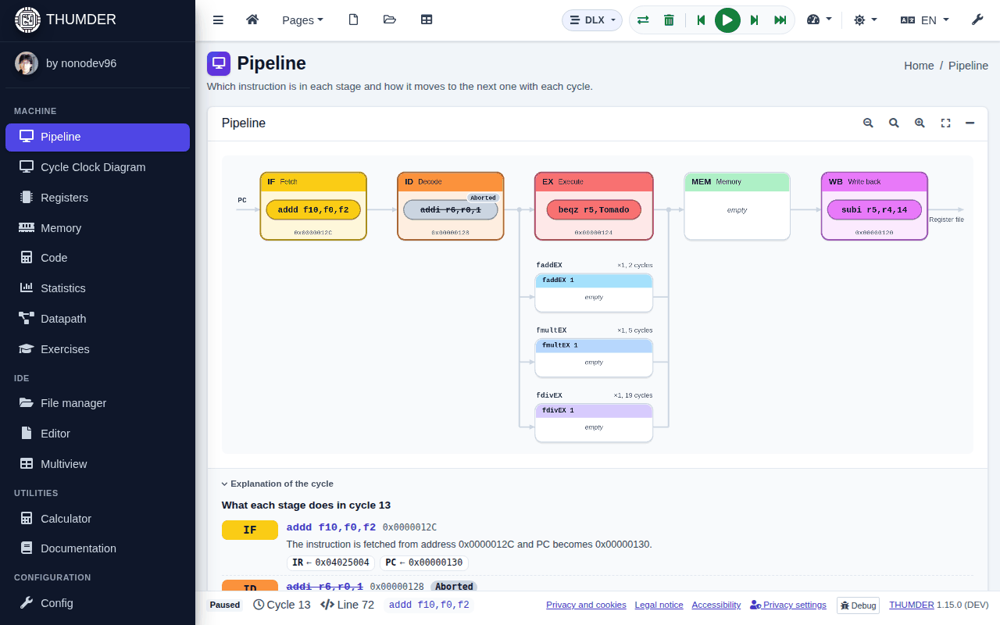
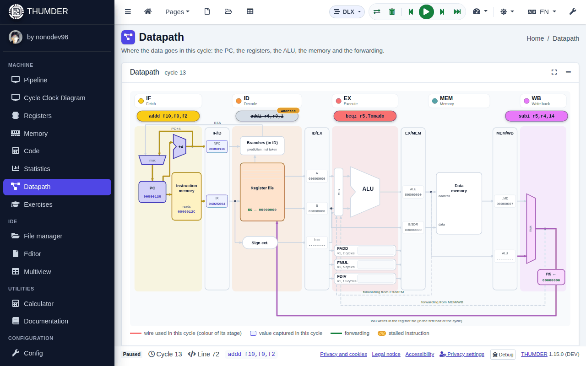
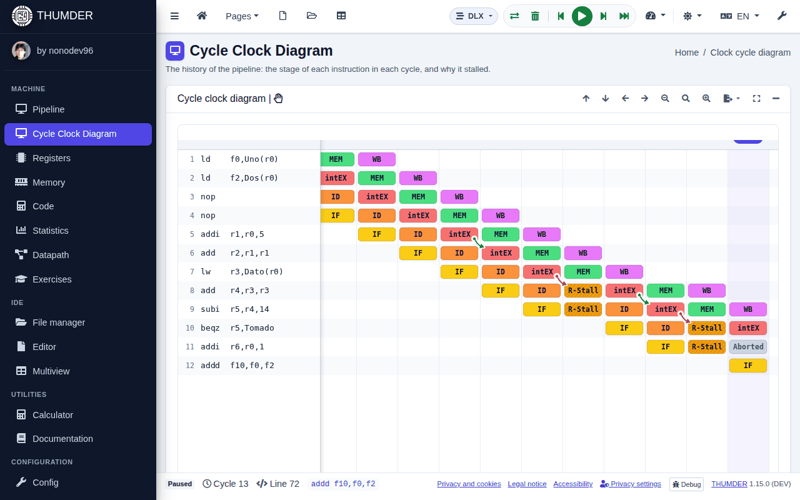

# THUMDER

<p align="center">
  
</p>

<p align="center">
  <strong>THe UltiMate Dlx EmulatoR</strong>: a simulator of the <strong>DLX</strong> processor to learn how a pipeline works, cycle by cycle.
</p>

<p align="center">
  <a href="https://thumder.netlify.app"><strong>Open in the browser</strong></a> |
  <a href="https://github.com/nonodev96/THUMDER/releases">Download the desktop application</a> |
  <a href="https://thumder.netlify.app/auth/documentation">Documentation</a>
</p>

<!-- github-only -->
<p align="center"><a href="README.md">Español</a> | <strong>English</strong></p>

<p align="center">
  <a href="https://github.com/nonodev96/THUMDER/actions/workflows/ci.yaml"></a>
  <a href="https://github.com/nonodev96/THUMDER/releases"></a>
  <a href="LICENSE.md"></a>
</p>
<!-- /github-only -->

<p align="center">
  
</p>

## What is THUMDER?

THUMDER is a visual simulator and a development environment for the **DLX** instruction set, the RISC architecture of
Hennessy and Patterson used to teach pipelining. You write a program in assembler, load it and watch, cycle by cycle, how
each instruction goes through the pipeline, which registers and which memory locations it changes, and why it stalls.

Everything happens in your browser or in the desktop application (Windows, Linux and macOS): the simulation engine is its
own, runs in a Web Worker and needs no server or account. On a phone it works like an application, and it can even be added
to the home screen.

## What you can do

**Program**

- A DLX assembler editor (Monaco) with highlighting, errors at once, breakpoints and symbols.
- A file manager with folders, import and download of `.s` and `.zip`, 20 commented classic examples, from "Hello, world" to an unrolled DAXPY, and 5 for SuperDLX.

**Simulate**

- Assembly to real DLX machine code and simulation of the WinDLX pipeline: IF, ID, EX, MEM and WB, forwarding, stalls and configurable floating point units.
- Two architectures, chosen in the header: **DLX** and **SuperDLX**, a superscalar DLX with out of order execution like the one of WinSuperDLX (several instructions per cycle, instruction windows, ROB, load and store buffers and branch prediction), with all its parameters configurable. The same program ends the same in both: only the cycles change.
- Continuous run, cycle by cycle, to the end without drawing and **step back**. The shortcuts are those of a debugger and do not clash with the browser's: <kbd>Ctrl</kbd>+<kbd>F9</kbd> loads, <kbd>F9</kbd> runs or pauses, <kbd>F8</kbd> goes one cycle forward, <kbd>Shift</kbd>+<kbd>F8</kbd> goes back and <kbd>Shift</kbd>+<kbd>F9</kbd> goes to the end.
- Input and output console for the traps of the program, and optional sound: each cycle is an arpeggio over a chord progression, the instructions that end carry the melody and the stalls and taken branches can be heard.

**Understand what happens**

| | |
| :-- | :-- |
| **Pipeline** | Each instruction in its stage and in the floating point units. With each cycle it moves to the next one, and the footer explains what each stage does with its instruction and which values it moves. |
| **Datapath** | The path of the data in the cycle: the PC that reads the instruction memory, the register file, the ALU, the data memory, the registers between stages (IF/ID, ID/EX, EX/MEM, MEM/WB) and the forwarding used. |
| **Cycle clock diagram** | The history of the pipeline. Pressing a stall, THUMDER explains which register was missing, which instruction produces it and whether forwarding would have avoided it. It exports to SVG, PNG and CSV. |
| **Registers and memory** | All the registers and every word of the memory, in binary, hexadecimal, integers, IEEE 754 or instructions. What the last cycle writes or reads is highlighted, and any value can be edited bit by bit. |
| **Code and statistics** | What each instruction of the program does and which stage it is in. The cycles, the CPI, the stalls by kind and the comparison with and without forwarding. |

**Practise**

- Guided exercises that THUMDER checks with the simulation itself, and programs shared as exercises with a link.
- A multiview with several windows at once, which are ordered by dragging or float over the others. On a phone they are chosen with chips.
- The documentation inside the application, in Spanish and English: how to use THUMDER, the DLX pipeline and an explorer of the 102 instructions (their syntax, their encoding field by field and what they do in each stage), with search and the opcode map.

**Anywhere**

- No account: it is used as a guest and the files are kept in the browser. With an account they are synchronised between devices.
- For phones: the title of the view at the top, the simulation controls at the bottom within reach of the thumb and views that scroll with a finger.
- Accessible: light or dark theme, text alternatives for each diagram and checks with axe (WCAG 2.1 AA) in each view.

<p align="center">
  
  
</p>

## Start in a minute

1. Open <https://thumder.netlify.app>. On a phone, the menu of the browser offers "Add to home screen".
2. In **File manager → ejemplos**, open for example `19-riesgos.s`.
3. Press **Load** (<kbd>Ctrl</kbd>+<kbd>F9</kbd>) and go on with **Step** (<kbd>F8</kbd>), looking at the **Pipeline** and the **Cycle Clock Diagram**.

The desktop application is in the [releases](https://github.com/nonodev96/THUMDER/releases): AppImage for Linux, installer
and portable for Windows, and `.dmg` and `.zip` for macOS. It is not signed. How to install each version, Android too:
[Install THUMDER](docs/guide/instalar.en.md). Step by step: [First steps](docs/guide/primeros-pasos.en.md).

## The simulator

THUMDER assembles the programs into real DLX machine code, loads them in memory and simulates them cycle by cycle with the
WinDLX pipeline: forwarding, stalls, configurable floating point units, input and output traps, and statistics.

- How it works and how it is checked: [docs/simulador.en.md](docs/simulador.en.md).
- SuperDLX, the superscalar DLX: [docs/superdlx.en.md](docs/superdlx.en.md).
- The WinDLX manual it is based on (in Spanish): [docs/manual-simulador-dlx.md](docs/manual-simulador-dlx.md).
- The 20 DLX examples and the 5 SuperDLX ones, explained: [docs/ejemplos-dlx.en.md](docs/ejemplos-dlx.en.md). They are always in the folder "ejemplos" of the file manager, read only, next to "ejercicios" with the programs of the guided exercises. If you change one, a copy is saved in your files.

## Development

Requirements: Node.js 22 (or 20.19 or later) and pnpm 10. `corepack enable` installs the version of `packageManager`.

```bash
git clone git@github.com:nonodev96/THUMDER.git
cd THUMDER
pnpm install
pnpm run ng:serve:dev   # http://localhost:4200
```

`pnpm install` creates the environment files (`src/environments/environment.{dev,web,production}.ts`) from
`src/environments/_environment.ts`. They are in `.gitignore` because they carry the Firebase keys:

- **Without Firebase keys** (local mode): there are no accounts, you come in as a guest, the files are kept in the browser (IndexedDB) and there are no analytics. It is what is needed to develop and for the tests.
- **With Firebase keys**: you also come in as a guest, and an account (email, Google or GitHub) synchronises the files with Firestore. There are analytics only if they are accepted in the privacy notice, and the error reports can be turned off in it (see the [privacy policy](src/assets/legal/privacy.en.md)). The Firestore rules are in `firestore.rules` and are tested with `pnpm test:rules`.

| **Command**             | **What it does**                                                                          |
| :---------------------- | :---------------------------------------------------------------------------------------- |
| `pnpm run ng:serve:dev` | Starts the web application at <http://localhost:4200>                                     |
| `pnpm start`            | The web application and Electron at once (Electron loads `localhost:4200`)                |
| `pnpm test`             | Unit tests (Vitest)                                                                       |
| `pnpm test:electron`    | Unit tests of the desktop application (`src-electron`), without opening Electron          |
| `pnpm test:rules`       | The Firestore rules in the emulator (needs Java)                                          |
| `pnpm e2e`              | e2e tests (Playwright) on desktop, phone and tablet, with axe; starts `ng serve`          |
| `pnpm e2e:electron`     | Builds the desktop application and tests it (on Linux without a screen: `xvfb-run -a`)    |
| `pnpm run lint`         | Lint and format (Biome)                                                                   |

How to contribute (structure, conventions, tests and publishing): [CONTRIBUTING.en.md](CONTRIBUTING.en.md).

### e2e tests

They are in `e2e/` and use Playwright. The first time, install the browser with `pnpm exec playwright install chromium`.

- `pnpm e2e` runs the checks on desktop (1440×900), phone (Pixel 7) and tablet (820×1180), with no errors in the page, and the phone and tablet ones also with WebKit, the engine of iOS (iPhone 15 and iPad). It covers the interface, the simulation, the examples, the settings, the tools to learn, the responsive interface in 5 sizes and the accessibility of each view in both themes.
- `pnpm e2e:electron` tests the desktop application: that it loads with `file://` and without Node.js in the page, the title bar,
  the theme, the menu and the maximised cards. Each test uses its own data folder, so it does not touch the one of whoever runs it.

The tests that depend on a size carry the tag `@movil` or `@tableta`. The screenshots and the traces of the failing ones are left
in `test-results/`, and the report, in `playwright-report/`.

## Build and deploy

| **Command**                    | **What it does**                                                                                   |
| :----------------------------- | :------------------------------------------------------------------------------------------------- |
| `pnpm run ng:build:production` | Optimised web application in `dist/browser` (the one deployed on Netlify)                          |
| `pnpm run build:prod`          | Application for Electron (`--base-href ./`) and the main process in `dist-electron/`               |
| `pnpm run electron:build`      | Desktop executable in `release/`: AppImage, Windows installer and portable, macOS `.dmg` and `.zip` |
| `pnpm run mobile:build`        | The web for the Android and iOS applications, copied into their projects (`src-mobile/`): see [docs/movil.en.md](docs/movil.en.md) |

A version is published with `pnpm version minor` (or `patch`), which writes its section in `CHANGELOG.md` from the
conventional commits and creates the tag, and then with `git push --follow-tags`. The GitHub Actions workflows:

| **Workflow**          | **When**                                  | **What it does**                                                                                          |
| :-------------------- | :---------------------------------------- | :-------------------------------------------------------------------------------------------------------- |
| `ci.yaml`             | each push to `dev` and `master` and each PR | lint, build, unit tests, Firestore rules, e2e (Chromium, WebKit and the desktop application) and the build of the Android and iOS applications |
| `deploy-netlify.yaml` | `v*` tag or by hand (*Run workflow*)      | unit tests, build, attestations and SBOM of the web, and production deploy on Netlify                     |
|                       | each PR and each push to `dev`            | preview at `https://pr-<number>--<site>.netlify.app` and `https://dev--<site>.netlify.app`                |
| `create-release.yaml` | `v*` tag                                  | a draft release with the executables of Linux, Windows and macOS (and the Android AAB and APK, if its key is there), the `latest*.yml` files, the notes of the CHANGELOG, the SBOM and the attestations of each executable |

The actions of the workflows are pinned by their commit (a tag can move; a commit cannot), and Dependabot proposes their new
versions every week (`.github/dependabot.yml`).

### Verify the downloads

THUMDER has no Windows or macOS code signing (the certificates cost money): SmartScreen and Gatekeeper warn the first time.
What each version does have is its verifiable **supply chain**:

- **Provenance (SLSA v1, in in-toto format)**: each executable, and each file of the web, has an attestation that says which
  repository, which commit and which workflow it came from (SLSA Build level 2). GitHub Actions signs it with **Sigstore**,
  without keys: a certificate of a few minutes issued for the identity of the workflow, which stays in the public
  transparency log.
- **SBOM**: the list of what THUMDER carries, in CycloneDX and SPDX, made with Syft from `pnpm-lock.yaml`. It includes
  everything it is built with: the dependencies of the application (Electron among them, which goes in the executables) and
  those of build and tests, and the actions of the workflows. It is attested too.

A downloaded executable of a version is checked with the [GitHub CLI](https://cli.github.com/):

```sh
gh attestation verify THUMDER-v1.12.1-linux-x86_64.AppImage --repo nonodev96/THUMDER \
  --signer-workflow nonodev96/THUMDER/.github/workflows/create-release.yaml
# Its SBOM
gh attestation verify THUMDER-v1.12.1-linux-x86_64.AppImage --repo nonodev96/THUMDER --predicate-type https://cyclonedx.org/bom
```

The version also has the SBOMs (`THUMDER-v<version>-sbom.cdx.json` and `.spdx.json`) and the attestations of each system
(`THUMDER-v<version>-<system>-provenance.sigstore.json` and `-sbom.sigstore.json`), in the Sigstore format. They are checked
offline with `gh attestation verify <file> --bundle <attestation> --repo nonodev96/THUMDER`, or with
[cosign](https://github.com/sigstore/cosign) (`--type cyclonedx` for the one of the SBOM):

```sh
cosign verify-blob-attestation --bundle THUMDER-v1.12.1-linux-provenance.sigstore.json --type slsaprovenance1 \
  --certificate-identity-regexp '^https://github.com/nonodev96/THUMDER/.github/workflows/create-release.yaml@refs/tags/v' \
  --certificate-oidc-issuer https://token.actions.githubusercontent.com THUMDER-v1.12.1-linux-x86_64.AppImage
```

The production web publishes its SHA-256 sums and its SBOM in `/integrity/` (`sha256sums.txt`, `sbom.cdx.json` and
`sbom.spdx.json`), and each file has its attestation. For example, the main code of the application:

```sh
curl -O https://thumder.netlify.app/integrity/sha256sums.txt
main=$(grep -oE 'main-[A-Z0-9]+\.js$' sha256sums.txt)
curl -O "https://thumder.netlify.app/$main"
sha256sum -c --ignore-missing sha256sums.txt
gh attestation verify "$main" --repo nonodev96/THUMDER --signer-workflow nonodev96/THUMDER/.github/workflows/deploy-netlify.yaml
```

The HTML pages are the exception: Netlify adds a comment to them when serving them, so they do not match the build byte by
byte. And `_redirects` is the configuration of Netlify: it is in the sums, but it is not served.

Deploying on Netlify needs two secrets of the repository:

- `NETLIFY_AUTH_TOKEN`: a personal Netlify token (*User settings → Applications*).
- `NETLIFY_SITE_ID`: the identifier of the project (*Project configuration → Project ID*).

With the optional secret `ANGULAR_ENVIROTMENT_PRODUCTION` (the file `src/environments/environment.production.ts` in base64),
the web carries the Firebase keys; without it, it is built in local mode. PRs from forks and from Dependabot have no access to
the secrets and are not deployed.

The desktop window (`src-electron/`) is the one of a system application:

- On Windows and Linux there is no Electron title bar or menu: the navigation bar of THUMDER is the title bar (it moves the
  window and maximises it with a double click) and the minimise, maximise and close buttons are drawn on its right, with the
  colours of the theme. macOS keeps its title bar and its menu bar.
- The theme "the one of the system" follows the desktop and changes with it. On Linux, besides what Chromium reads (the
  preference of the portal and the GTK theme), the theme of the desktop itself counts (Cinnamon, GNOME, MATE), which can have
  dark panels and light applications. The menus, the scroll bars and the native dialogs follow the chosen theme.
- The menu has the zoom (<kbd>Ctrl</kbd>+<kbd>+</kbd>, <kbd>Ctrl</kbd>+<kbd>-</kbd>, <kbd>Ctrl</kbd>+<kbd>0</kbd>), full
  screen, copy and paste, and help (<kbd>F1</kbd>), in the language of THUMDER.
- A maximised card starts under the navigation bar: its buttons do not end up under those of the window, and the bar is
  still the title bar, with the simulation controls at hand.
- The menu and the tray use the translations of THUMDER (the `DESKTOP` section of `src/assets/i18n`), as the page does.
- The window opens without flashes with the colour of the theme, remembers its size and its place (`desktop.json`, in the
  data folder of the application), and opening THUMDER again shows the one already open. It has an icon in the system tray.
- The icons of the installers are in `build/` (`icons/` for Linux, `icon.ico` and `icon.icns`).

The desktop application gives the page no access to Node.js: what it needs from Electron (opening links in the browser, the
theme of the desktop, the height of the title bar and the routes of the menu) is exposed by the *preload* as `window.thumder`,
and the main process only serves the pages of THUMDER and checks what they send. The page has a content security policy (CSP
in `src/index.html`) without `eval` or inline scripts, and the desktop package only carries `dist-electron/` and the built
application.

```
src-electron/
  shared/contract.ts   the contract between the three parts: the channels, their data and window.thumder (types only)
  preload/             window.thumder (in the sandbox: only uses types of the contract)
  main/
    index.ts           the entry point: a single instance
    app.ts             joins the pieces: settings, theme, window, menus, tray and IPC
    environment.ts     where it runs: paths of the application, of its assets and of the preload
    settings.ts        what it remembers (desktop.json)
    i18n.ts            the texts, from src/assets/i18n
    ipc.ts             what the page asks for, validated (validation.ts)
    links.ts           what is a page of THUMDER and what opens in the browser
    menu/              the templates of the menu and of the tray
    theme/             the theme of the window and the one of the Linux desktop (gsettings)
    window/            the window and its sizes (where it opens, the height of its buttons, the zoom)
```

What does not need Electron (the settings, the theme, the menus, the texts, the sizes, the validation) gets what it uses from
Electron as a parameter and has its tests next to it (`*.spec.ts`, `pnpm test:electron`). The window is tested with
`pnpm e2e:electron`.

### Android and iOS

The Android and iOS applications are the same Angular application inside [Capacitor](https://capacitorjs.com)
(`capacitor.config.ts` and `src-mobile/`): they fill the whole screen with the system bars in the colour of the theme, the
Android back button closes what is open before going back, external links open in the browser of the system, saving a file
opens the share menu and signing in with Google, GitHub and Apple is the system one. They are built with
`pnpm run mobile:android` and `pnpm run mobile:ios`; how to configure, sign and publish them is in
[docs/movil.en.md](docs/movil.en.md).

## Documentation

The documentation is inside THUMDER (**Documentation**, in the side menu), in [`docs/`](docs/README.md) and in the [wiki](https://github.com/nonodev96/THUMDER/wiki), in Spanish and English:

- **Get started**: [What is THUMDER?](docs/guide/que-es-thumder.en.md), [First steps](docs/guide/primeros-pasos.en.md) and [Install THUMDER](docs/guide/instalar.en.md).
- **Use THUMDER**: [Files and editor](docs/guide/ficheros-y-editor.en.md), [Simulate a program](docs/guide/simular.en.md), [The views](docs/guide/vistas.en.md), [Settings](docs/guide/configuracion.en.md), [Account and privacy](docs/guide/cuenta.en.md) and [FAQ](docs/guide/preguntas.en.md).
- **Learn DLX**: [The DLX pipeline](docs/guide/pipeline.en.md), [SuperDLX](docs/superdlx.en.md), [Commented examples](docs/ejemplos-dlx.en.md) and [Exercises](docs/guide/ejercicios.en.md).
- **Reference**: the instruction table (inside THUMDER), [the instruction set](src/assets/docs.md), [the opcodes](src/assets/dlxmap.md) and [the WinDLX manual](docs/manual-simulador-dlx.md), in Spanish.
- **Development**: [How to contribute](CONTRIBUTING.en.md), [The simulator inside](docs/simulador.en.md) and [The Android and iOS applications](docs/movil.en.md).

## Licence

[MIT](LICENSE.md) © Antonio Mudarra Machuca. THUMDER started as a Bachelor's thesis at the University of Jaén.
