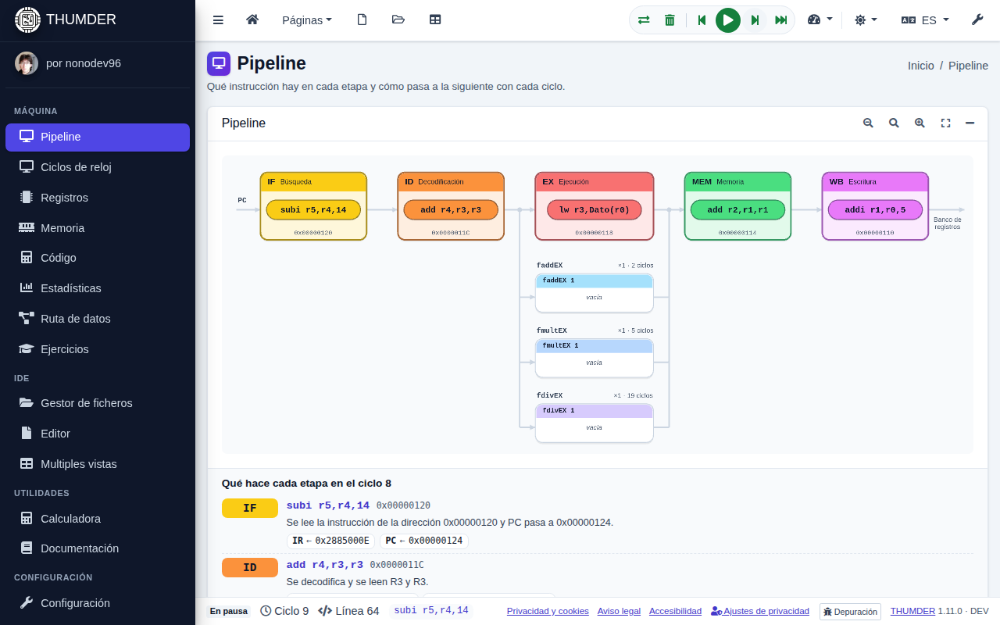
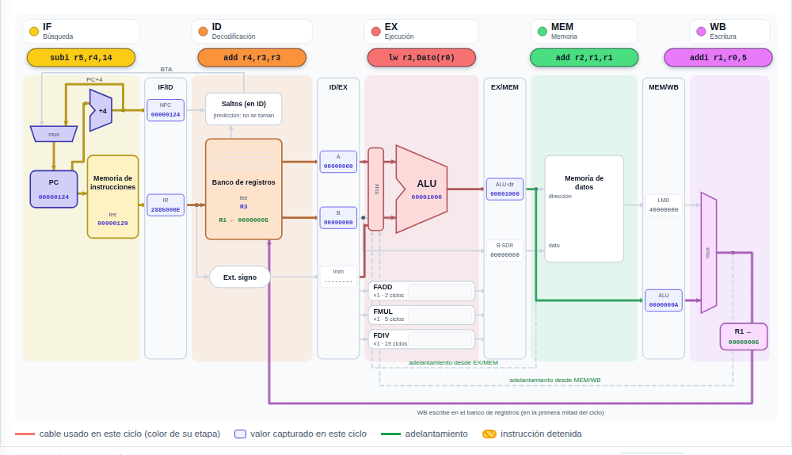
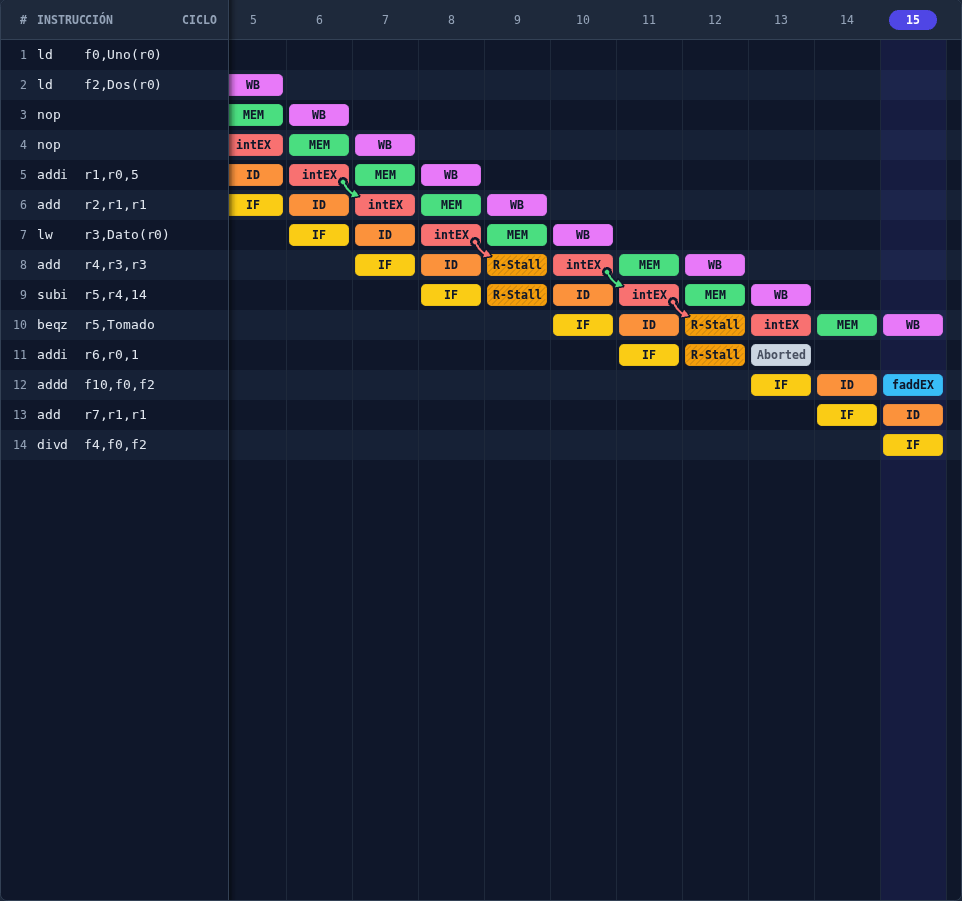
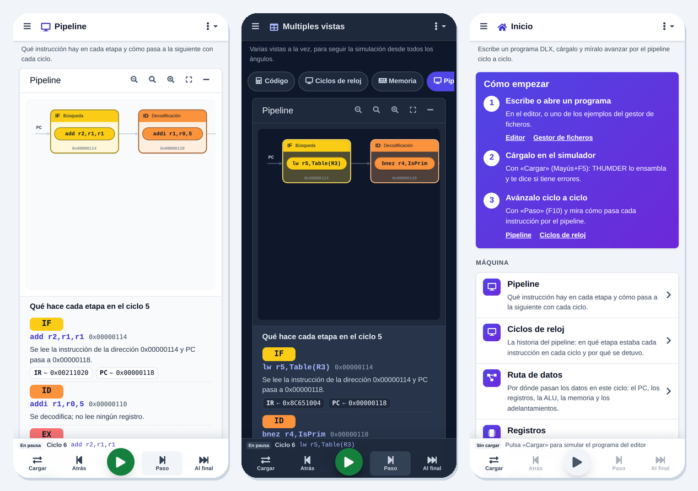

# THUMDER

<p align="center">
  
</p>

<p align="center">
  <strong>THe UltiMate Dlx EmulatoR</strong>: un simulador del procesador <strong>DLX</strong> para aprender cómo funciona un pipeline, ciclo a ciclo.
</p>

<p align="center">
  <a href="https://thumder.netlify.app"><strong>Abrir en el navegador</strong></a> ·
  <a href="https://github.com/nonodev96/THUMDER/releases">Descargar la aplicación de escritorio</a> ·
  <a href="https://thumder.netlify.app/auth/documentation">Documentación</a>
</p>

<!-- github-only -->
<p align="center">
  <a href="https://github.com/nonodev96/THUMDER/actions/workflows/ci.yaml"></a>
  <a href="https://github.com/nonodev96/THUMDER/releases"></a>
  <a href="LICENSE.md"></a>
</p>
<!-- /github-only -->

<p align="center">
  
</p>

## ¿Qué es THUMDER?

THUMDER es un simulador visual y un entorno de desarrollo para el repertorio de instrucciones **DLX**, la arquitectura RISC de
Hennessy y Patterson con la que se enseña la segmentación. Escribes un programa en ensamblador, lo cargas y ves, ciclo a ciclo,
cómo avanza cada instrucción por el pipeline, qué registros y qué posiciones de memoria cambia, y por qué se detiene.

Todo ocurre en tu navegador o en la aplicación de escritorio (Windows, Linux y macOS): el motor de simulación es propio, corre en
un Web Worker y no necesita servidor ni cuenta. En el móvil se usa como una aplicación, e incluso se puede instalar en la
pantalla de inicio.

## Qué puedes hacer

**Programar**

- Un editor de ensamblador DLX (Monaco) con resaltado, errores al momento, puntos de ruptura y símbolos.
- Un gestor de ficheros con carpetas, importación y descarga de `.s` y `.zip`, y 20 ejemplos clásicos comentados, de «Hola, mundo» a un DAXPY desenrollado.

**Simular**

- Ensamblado a código máquina DLX real y simulación del pipeline de WinDLX: IF, ID, EX, MEM y WB, adelantamiento, detenciones y unidades de coma flotante configurables.
- Ejecución continua, ciclo a ciclo, hasta el final sin dibujar y **paso atrás**. Los atajos son los de un depurador y no chocan con los del navegador: <kbd>Ctrl</kbd>+<kbd>F9</kbd> carga, <kbd>F9</kbd> ejecuta o pausa, <kbd>F8</kbd> avanza un ciclo, <kbd>Mayús</kbd>+<kbd>F8</kbd> retrocede y <kbd>Mayús</kbd>+<kbd>F9</kbd> va al final.
- Consola de entrada y salida para los traps del programa, y sonido opcional: cada ciclo es un arpegio sobre una progresión de acordes, las instrucciones que terminan llevan la melodía y las detenciones y los saltos tomados se oyen.

**Entender lo que pasa**

| | |
| :-- | :-- |
| **Pipeline** | Cada instrucción en su etapa y en las unidades de coma flotante. Con cada ciclo se desplaza a la siguiente, y el pie explica qué hace cada etapa con la suya y qué valores mueve. |
| **Ruta de datos** | El camino de los datos en el ciclo: el PC que lee la memoria de instrucciones, el banco de registros, la ALU, la memoria de datos, los registros entre etapas (IF/ID, ID/EX, EX/MEM, MEM/WB) y los adelantamientos que se usan. |
| **Diagrama de ciclos** | La historia del pipeline. Al pulsar un atasco, THUMDER explica qué registro faltaba, qué instrucción lo produce y si el adelantamiento lo habría evitado. Se exporta a SVG, PNG y CSV. |
| **Registros y memoria** | Todos los registros y cada palabra de la memoria, en binario, hexadecimal, enteros, IEEE 754 o instrucciones. Lo que escribe o lee el último ciclo se resalta, y cualquier valor se edita bit a bit. |
| **Código y estadísticas** | Qué hace cada instrucción del programa y en qué etapa está. Los ciclos, el CPI, las detenciones por tipo y la comparación con y sin adelantamiento. |

**Practicar**

- Ejercicios guiados que THUMDER comprueba con la propia simulación, y programas compartidos como ejercicio con un enlace.
- Una vista múltiple con varias ventanas a la vez, que se ordenan arrastrando o flotan sobre las demás. En el móvil se eligen con chips.
- La documentación dentro de la aplicación: cómo se usa THUMDER, la arquitectura DLX y un explorador de las 102 instrucciones (su sintaxis, su codificación campo a campo y qué hace en cada etapa), con buscador y el mapa de códigos de operación.

**En cualquier sitio**

- Sin cuenta: se usa como invitado y los ficheros se guardan en el navegador. Con una cuenta se sincronizan entre dispositivos.
- Para móvil: título de la vista arriba, controles de la simulación abajo al alcance del pulgar y vistas que se desplazan con el dedo.
- Accesible: tema claro u oscuro, alternativas en texto a cada diagrama y comprobación con axe (WCAG 2.1 AA) en cada vista.

<p align="center">
  
  
</p>
<p align="center">
  
</p>

## Empieza en un minuto

1. Abre <https://thumder.netlify.app>. En el móvil, el menú del navegador ofrece «Añadir a la pantalla de inicio».
2. En **Gestor de ficheros → ejemplos**, abre por ejemplo `19-riesgos.s`.
3. Pulsa **Cargar** (<kbd>Ctrl</kbd>+<kbd>F9</kbd>) y avanza con **Paso** (<kbd>F8</kbd>), mirando el **Pipeline** y el **Diagrama de ciclos**.

La aplicación de escritorio está en las [versiones](https://github.com/nonodev96/THUMDER/releases): AppImage para Linux,
instalador y portable para Windows, y `.dmg` y `.zip` para macOS. No está firmada.

## El simulador

THUMDER ensambla los programas en código máquina DLX real, los carga en memoria y los simula ciclo a ciclo con el pipeline de
WinDLX: adelantamiento, detenciones, unidades de coma flotante configurables, traps de entrada y salida, y estadísticas.

- Cómo funciona y cómo se comprueba: [docs/simulador.md](docs/simulador.md).
- El manual de WinDLX en el que se basa: [docs/manual-simulador-dlx.md](docs/manual-simulador-dlx.md).
- Los 20 ejemplos, explicados: [docs/ejemplos-dlx.md](docs/ejemplos-dlx.md). Están siempre en la carpeta «ejemplos» del gestor de ficheros, de solo lectura, junto a «ejercicios» con los programas de los ejercicios guiados. Si cambias uno, se guarda una copia en tus ficheros.

## Desarrollo

Requisitos: Node.js 22 (o 20.19 o posterior) y pnpm 10. `corepack enable` instala la versión de `packageManager`.

```bash
git clone --recurse-submodules git@github.com:nonodev96/THUMDER.git
cd THUMDER
pnpm install
pnpm run ng:serve:dev   # http://localhost:4200
```

`pnpm install` crea los ficheros de entorno (`src/environments/environment.{dev,web,production}.ts`) a partir de
`src/environments/_environment.ts`. Están en `.gitignore` porque llevan las claves de Firebase:

- **Sin claves de Firebase** (modo local): no hay cuentas, se entra como invitado, los ficheros se guardan en el navegador (IndexedDB) y no hay analítica. Es lo que hace falta para desarrollar y para las pruebas.
- **Con claves de Firebase**: también se entra como invitado, y una cuenta (correo, Google o GitHub) sincroniza los ficheros con Firestore. Solo hay analítica si se acepta en el aviso de privacidad, y los informes de errores se pueden desactivar en él (ver la [política de privacidad](src/assets/legal/privacy.es.md)). Las reglas de Firestore están en `firestore.rules` y se prueban con `pnpm test:rules`.

| **Comando**             | **Qué hace**                                                                            |
| :---------------------- | :-------------------------------------------------------------------------------------- |
| `pnpm run ng:serve:dev` | Arranca la aplicación web en <http://localhost:4200>                                    |
| `pnpm start`            | La aplicación web y Electron a la vez (Electron carga `localhost:4200`)                 |
| `pnpm test`             | Pruebas unitarias (Vitest)                                                              |
| `pnpm test:rules`       | Las reglas de Firestore en el emulador (necesita Java)                                  |
| `pnpm e2e`              | Pruebas e2e (Playwright) en escritorio, móvil y tableta, con axe; arranca `ng serve`    |
| `pnpm e2e:electron`     | Compila la aplicación de escritorio y la prueba (en Linux sin pantalla: `xvfb-run -a`) |
| `pnpm run lint`         | Lint y formato (Biome)                                                                  |

Cómo contribuir (estructura, convenciones, pruebas y publicación): [CONTRIBUTING.md](CONTRIBUTING.md).

### Pruebas e2e

Están en `e2e/` y usan Playwright. La primera vez hay que instalar el navegador con `pnpm exec playwright install chromium`.

- `pnpm e2e` hace las comprobaciones en escritorio (1440×900), móvil (Pixel 7) y tableta (820×1180), sin errores en la página. Cubre la interfaz, la simulación, los ejemplos, la configuración, las herramientas para aprender, la interfaz adaptable en 5 tamaños y la accesibilidad de cada vista en los dos temas.
- `pnpm e2e:electron` prueba la aplicación de escritorio: que carga con `file://` y sin Node.js en la página.

Las pruebas que dependen de un tamaño llevan la etiqueta `@movil` o `@tableta`. Las capturas y las trazas de las que fallan quedan
en `test-results/`, y el informe, en `playwright-report/`.

## Compilación y despliegue

| **Comando**                    | **Qué hace**                                                                                       |
| :----------------------------- | :------------------------------------------------------------------------------------------------- |
| `pnpm run ng:build:production` | Aplicación web optimizada en `dist/browser` (la que se despliega en Netlify)                       |
| `pnpm run build:prod`          | Aplicación para Electron (`--base-href ./`) y `main.js`/`preload.js`                               |
| `pnpm run electron:build`      | Ejecutable de escritorio en `release/`: AppImage, instalador y portable de Windows, `.dmg` y `.zip` de macOS |

Una versión se publica con `pnpm version minor` (o `patch`), que escribe su sección en `CHANGELOG.md` a partir de los commits
convencionales y crea la etiqueta, y luego con `git push --follow-tags`. Los flujos de GitHub Actions:

| **Flujo**             | **Cuándo**                                | **Qué hace**                                                                                              |
| :-------------------- | :---------------------------------------- | :-------------------------------------------------------------------------------------------------------- |
| `ci.yaml`             | cada push a `dev` y `master` y cada PR    | lint, compilación, pruebas unitarias, reglas de Firestore y e2e (Chromium y la aplicación de escritorio)  |
| `deploy-netlify.yaml` | etiqueta `v*` o a mano (*Run workflow*)   | pruebas unitarias, compilación y despliegue en producción en Netlify                                      |
|                       | cada PR y cada push a `dev`               | vista previa en `https://pr-<número>--<sitio>.netlify.app` y `https://dev--<sitio>.netlify.app`          |
| `create-release.yaml` | etiqueta `v*`                             | un borrador de versión con los ejecutables de Linux, Windows y macOS, los `latest*.yml` y las notas del CHANGELOG |

Para desplegar en Netlify hacen falta dos secretos del repositorio:

- `NETLIFY_AUTH_TOKEN`: un token personal de Netlify (*User settings → Applications*).
- `NETLIFY_SITE_ID`: el identificador del proyecto (*Project configuration → Project ID*).

Con el secreto opcional `ANGULAR_ENVIROTMENT_PRODUCTION` (el fichero `src/environments/environment.production.ts` en base64), la
web lleva las claves de Firebase; sin él se compila en modo local. Los PR de forks y de Dependabot no tienen acceso a los secretos
y no se despliegan.

La aplicación de escritorio no da a la página acceso a Node.js: lo que necesita de Electron (abrir enlaces en el navegador y las
notificaciones) lo expone `preload.ts` como `window.thumder`. La página tiene una política de seguridad de contenidos (CSP en
`src/index.html`) sin `eval` ni scripts en línea, y el paquete de escritorio solo lleva `main.js`, `preload.js` y la aplicación
compilada.

## Documentación

La documentación está dentro de la aplicación, en **Documentación**, y como ficheros Markdown en el repositorio:

- [Primeros pasos](docs/primeros-pasos.md) y los ejemplos: [docs/ejemplos-dlx.md](docs/ejemplos-dlx.md).
- El uso de cada ventana, en la [wiki](https://github.com/nonodev96/THUMDER/wiki):
  - [El proceso de simulación](https://github.com/nonodev96/THUMDER/wiki/07.TheExecutionProcess)
  - [La ventana del cauce (Pipeline)](https://github.com/nonodev96/THUMDER/wiki/04.ThePipelineWindow)
  - [El diagrama de ciclos de reloj](https://github.com/nonodev96/THUMDER/wiki/04.TheClockCycleDiagramWindow)
  - [Los registros](https://github.com/nonodev96/THUMDER/wiki/01.TheRegisterWindow)
  - [La memoria](https://github.com/nonodev96/THUMDER/wiki/02.TheMemoryWindow)
  - [El código](https://github.com/nonodev96/THUMDER/wiki/03.TheCodeWindow)
  - [Las estadísticas](https://github.com/nonodev96/THUMDER/wiki/05.TheStatisticsWindow)
  - [Los puntos de ruptura](https://github.com/nonodev96/THUMDER/wiki/06.TheBreakpoints)
  - [La configuración](https://github.com/nonodev96/THUMDER/wiki/08.TheConfiguration)
  - [El gestor de ficheros](https://github.com/nonodev96/THUMDER/wiki/09.FileManager)
  - [El editor](https://github.com/nonodev96/THUMDER/wiki/10.FileEditor)
  - [La vista múltiple](https://github.com/nonodev96/THUMDER/wiki/11.Multiview)
  - [La instalación](https://github.com/nonodev96/THUMDER/wiki/0.Installation)
  - [La cuenta](https://github.com/nonodev96/THUMDER/wiki/00.Account)
  - [La ejecución de las instrucciones](https://github.com/nonodev96/THUMDER/wiki/00.TheExecutionOfInstructions)

## Licencia

[MIT](LICENSE.md) © Antonio Mudarra Machuca. THUMDER nació como Trabajo Fin de Grado en la Universidad de Jaén.
