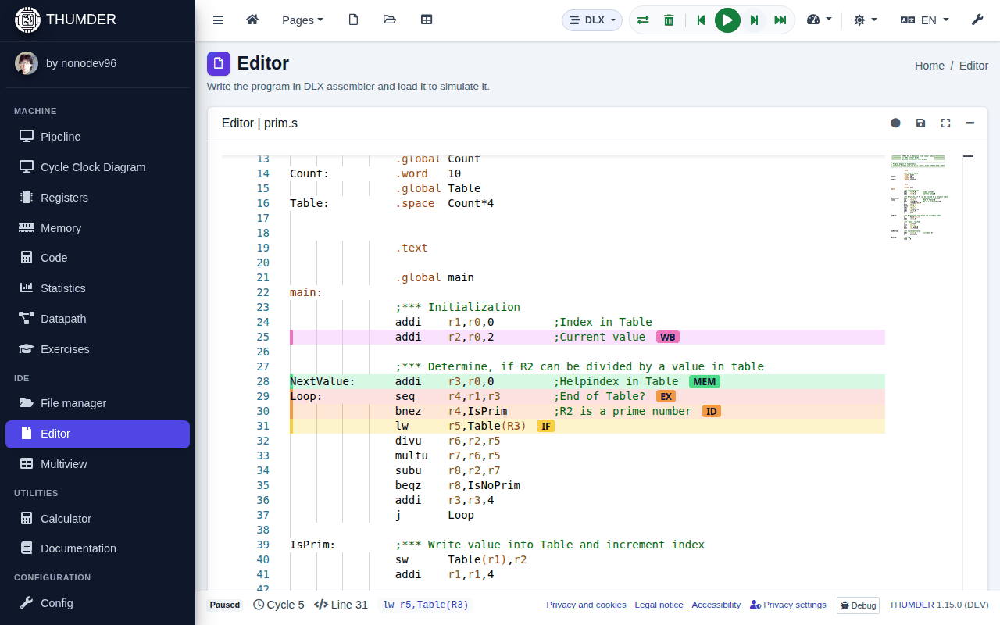

# First steps

Your first simulation in five minutes. No account and nothing to install: open <https://thumder.netlify.app> or the desktop application.

## 1. Open a program

1. In the side menu, press **File manager**.
2. Go into the folder **ejemplos** (examples) and double click `02-suma-vector.s`.

The program opens in the **Editor**. The header of the file explains what it teaches and what to look at while it runs. The examples are commented in Spanish.

> The folders **ejemplos** and **ejercicios** are read only. If you change one of their programs, saving creates a copy in **mis ejemplos**. To start your own: **New → DLX program (.s)**.

## 2. Load the code

Press **Load** in the top bar (the two arrows, <kbd>Ctrl</kbd>+<kbd>F9</kbd>). THUMDER assembles the program, puts the code and the data in the memory and leaves the machine at cycle 0.

If there are errors, they are marked on their line of the editor and in the **Problems** panel, under the editor.

## 3. Go cycle by cycle

Press **Step** (<kbd>F8</kbd>) a few times. In the editor, each instruction in the pipeline has a label with its stage (IF, ID, EX, MEM or WB), and the line takes the colour of that stage.

At the bottom, the status bar shows the cycle, the line and the instruction just fetched.

## 4. Look at what happens

Open the views of the **Machine** group of the side menu while you go:

- **Pipeline**: which instruction is in each stage and what each stage does in this cycle.
- **Cycle Clock Diagram**: the history of each instruction. Stalls are striped: press one to know why it happens.
- **Registers** and **Memory**: the values that change are highlighted.

All the views are explained in [The views](vistas.en.md).

## 5. Run to the end

- **Run** (<kbd>F9</kbd>) goes on by itself, at the chosen speed; press it again to pause.
- **To end** (<kbd>Shift</kbd>+<kbd>F9</kbd>) reaches the end without drawing each cycle.
- **Back** (<kbd>Shift</kbd>+<kbd>F8</kbd>) undoes the last cycle.

What the program prints appears in the **Console of the program**, which opens by itself. Then look at the **Statistics**: cycles, CPI and where the time goes.

## What next

- [Simulate a program](simular.en.md): all the controls, the breakpoints and the console.
- [Exercises](ejercicios.en.md): questions that THUMDER checks with the simulation itself.
- [The DLX pipeline](pipeline.en.md): why instructions stall and how to avoid it.
