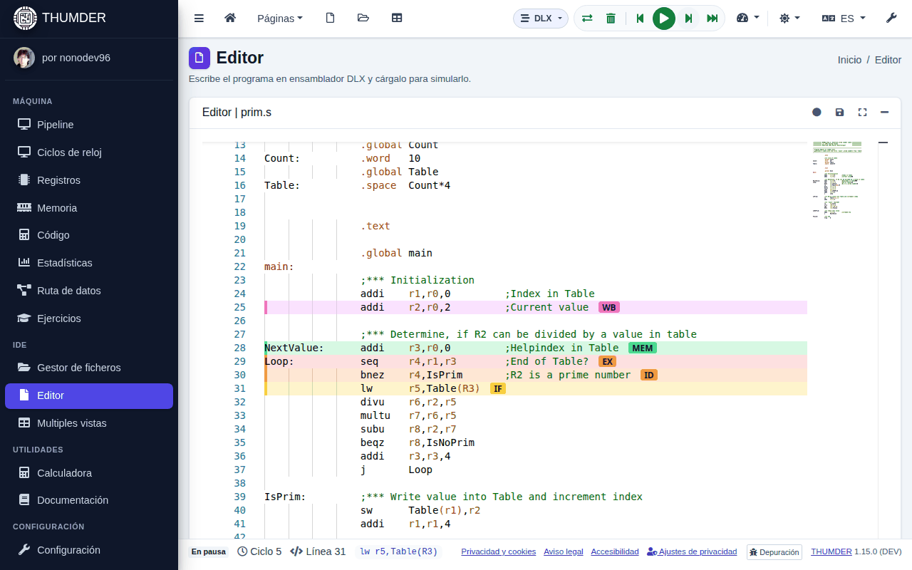

# Primeros pasos

Tu primera simulación en cinco minutos. No hace falta cuenta ni instalar nada: abre <https://thumder.netlify.app> o la aplicación de escritorio.

## 1. Abre un programa

1. En el menú lateral, pulsa **Gestor de ficheros**.
2. Entra en la carpeta **ejemplos** y haz doble clic en `02-suma-vector.s`.

El programa se abre en el **Editor**. La cabecera del fichero explica qué enseña y qué mirar mientras se ejecuta.

> Las carpetas **ejemplos** y **ejercicios** son de solo lectura. Si cambias un programa suyo, al guardar se crea una copia en **mis ejemplos**. Para empezar uno tuyo: **Nuevo → Programa DLX (.s)**.

## 2. Carga el código

Pulsa **Cargar** en la barra superior (las dos flechas, <kbd>Ctrl</kbd>+<kbd>F9</kbd>). THUMDER ensambla el programa, pone el código y los datos en la memoria y deja la máquina en el ciclo 0.

Si hay errores, se marcan en su línea del editor y en el panel **Problemas**, debajo del editor.

## 3. Avanza ciclo a ciclo

Pulsa **Paso** (<kbd>F8</kbd>) varias veces. En el editor, cada instrucción que está en el pipeline lleva una etiqueta con su etapa (IF, ID, EX, MEM o WB) y la línea se colorea con el color de esa etapa.

Abajo, la barra de estado dice el ciclo, la línea y la instrucción que se acaba de captar.

## 4. Mira qué pasa

Abre las vistas del grupo **Máquina** del menú lateral mientras avanzas:

- **Pipeline**: qué instrucción hay en cada etapa y qué hace cada etapa en este ciclo.
- **Ciclos de reloj**: la historia de cada instrucción. Las detenciones salen rayadas: pulsa una para saber por qué ocurre.
- **Registros** y **Memoria**: los valores que cambian se resaltan.

Todas las vistas se explican en [Las vistas](vistas.md).

## 5. Ejecuta hasta el final

- **Ejecutar** (<kbd>F9</kbd>) avanza solo, a la velocidad elegida; vuelve a pulsarlo para pausar.
- **Al final** (<kbd>Mayús</kbd>+<kbd>F9</kbd>) llega al final sin dibujar cada ciclo.
- **Atrás** (<kbd>Mayús</kbd>+<kbd>F8</kbd>) deshace el último ciclo.

Lo que imprime el programa sale en la **Consola del programa**, que se abre sola. Después, mira las **Estadísticas**: ciclos, CPI y en qué se pierde el tiempo.

## Y ahora

- [Simular un programa](simular.md): todos los controles, los puntos de ruptura y la consola.
- [Ejercicios](ejercicios.md): preguntas que THUMDER comprueba con la propia simulación.
- [El pipeline de DLX](pipeline.md): por qué se detienen las instrucciones y cómo evitarlo.
