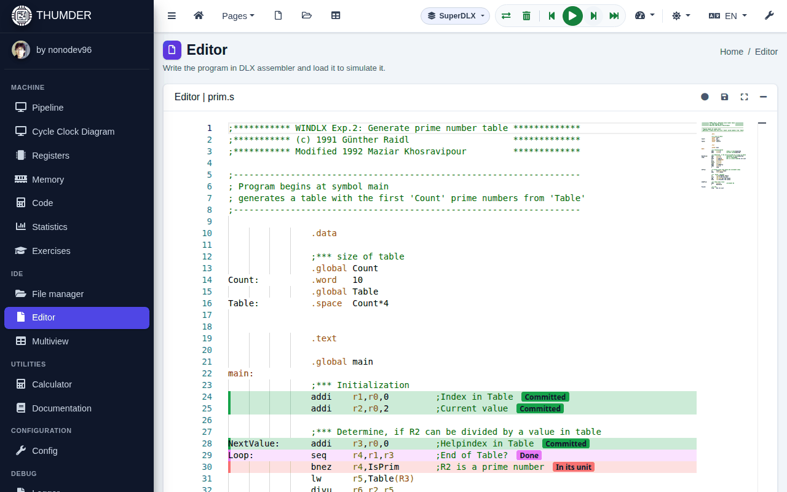

# Simulate a program

Everything is controlled from the top bar, in any view. On a phone, the controls are in a bar at the bottom, within reach of the thumb.

## The controls

| Button | Keyboard | What it does |
| :-- | :-- | :-- |
| **Load** (two arrows) | <kbd>Ctrl</kbd>+<kbd>F9</kbd> | Assembles the program of the editor and leaves the machine at cycle 0 |
| **Back** | <kbd>Shift</kbd>+<kbd>F8</kbd> | Goes back to the previous cycle |
| **Run** / **Pause** | <kbd>F9</kbd> | Goes on by itself, cycle by cycle, until you pause it |
| **Step** | <kbd>F8</kbd> | Goes one cycle forward |
| **To end** | <kbd>Shift</kbd>+<kbd>F9</kbd> | Runs to the end without drawing each cycle, much faster |
| **Reset the machine** (bin) | | Sets the memory, the code and the registers to zero |

The shortcuts are those of a debugger and do not clash with the browser's. The **speed** menu (the gauge) chooses the pace of **Run**, from **Maximum** to **Very slow**, and turns the sound on or off.

**Back** is exact: it repeats the simulation up to the previous cycle with everything you did (lines typed in the console, registers and memory changed by hand).

## When it stops

The run stops by itself:

- when the program ends (`trap 0`);
- at a breakpoint;
- at an error of the program, such as an address outside the memory or an integer division by zero: the message and the address are shown;
- when the program asks for a line on the console (`trap 3`).

The status bar, at the bottom, says what the machine is doing (not loaded, loaded, running, paused, finished...), the cycle and the line of the instruction just fetched.

## Follow the run in the editor

While you simulate, the editor marks each instruction in the machine:

- In **DLX**, with the stage it is in: IF, ID, EX (or the floating point unit), MEM or WB. Each stage has its colour.
- In **SuperDLX**, with its state: in the queue, in the window, in its unit, waits for memory, reads memory, done, committed or squashed.

The editor scrolls to follow the instruction just fetched (in SuperDLX, the one committed).

## DLX or SuperDLX

The architecture button, in the top bar, chooses the machine: **DLX** (one instruction per cycle, in order) or **SuperDLX** (several per cycle, out of order). Changing it loads the program again in the other machine. An exercise can lock it while it is open. How SuperDLX works: [SuperDLX](../superdlx.en.md).

## Breakpoints

A breakpoint stops the run at a line of the program.

- **Set or remove one**: click the left margin of the line, or put the cursor on it and press the circle button of the editor.
- **Choose when it stops**: in **Tools of the program → Breakpoints**, each line has its stage. IF stops when the instruction is fetched; ID, EX, MEM or WB, when it reaches that stage.
- **Watch the memory**: in the same panel, write an address in hexadecimal, its size and whether reading, writing or both are watched. The run stops when a load reads or a store writes it.

Breakpoints are saved with the file (with **Auto save**, when you leave the editor).

## The console of the program

What the program writes with the traps appears in the **Console of the program (DLX-I/O)**, which opens by itself.

- **Screen**: what the program writes (the error output, in red) and what you type.
- **Traps**: each input or output trap, with its cycle, its bytes and its data.

When the program asks for a line (`trap 3`), the console says so and waits: type the line and press <kbd>Enter</kbd>. The arrows bring back the previous lines. A light shows what the program is doing: green while it runs, amber while it waits and red when it has ended.

| Trap | What it does |
| :-- | :-- |
| 0 | Ends the program |
| 1 and 2 | Open and close files: there are no files in THUMDER, so `open` returns -1 |
| 3 | Reads a line of the console and copies its bytes to the memory |
| 4 | Writes bytes of the memory on the screen |
| 5 | `printf`: writes a formatted text |

The parameters of each trap are in the memory, from the address in R14, and the result is left in R1.

## Change values by hand

With the simulation paused, you can change any register from **Registers** and any data from **Memory**: press the name of the register or the address (they have a pencil) and write the value in decimal, hexadecimal, binary or floating point, or change its bits one by one. The program goes on with the new value. It is explained in [The views](vistas.en.md).

## The sound

If you turn it on, the simulation sounds: each stage has its note (with the pipeline full, each cycle is a chord), a stall sounds like a dull knock and an instruction squashed by a branch, like something falling. It is turned on from the speed menu or in **Config → Sound**.
