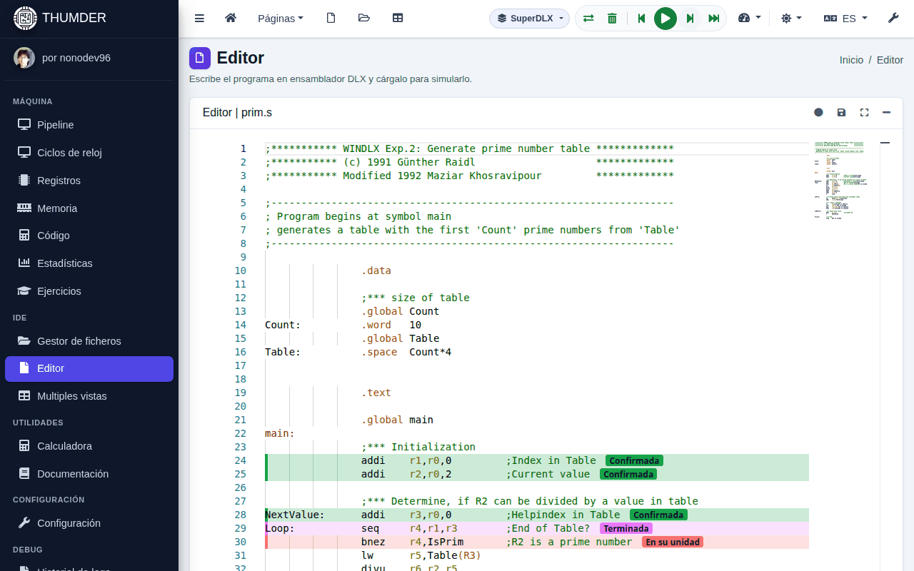

# Simular un programa

Todo se controla desde la barra superior, en cualquier vista. En el móvil, los controles están en una barra abajo, al alcance del pulgar.

## Los controles

| Botón | Teclado | Qué hace |
| :-- | :-- | :-- |
| **Cargar** (dos flechas) | <kbd>Ctrl</kbd>+<kbd>F9</kbd> | Ensambla el programa del editor y deja la máquina en el ciclo 0 |
| **Atrás** | <kbd>Mayús</kbd>+<kbd>F8</kbd> | Vuelve al ciclo anterior |
| **Ejecutar** / **Pausa** | <kbd>F9</kbd> | Avanza solo, ciclo a ciclo, hasta que lo pausas |
| **Paso** | <kbd>F8</kbd> | Avanza un ciclo |
| **Al final** | <kbd>Mayús</kbd>+<kbd>F9</kbd> | Ejecuta hasta el final sin dibujar cada ciclo, mucho más rápido |
| **Reiniciar la máquina** (papelera) | | Pone a cero la memoria, el código y los registros |

Los atajos son los de un depurador y no chocan con los del navegador. El menú de la **velocidad** (el indicador) elige el ritmo de **Ejecutar**, de **Máxima** a **Muy lenta**, y activa o quita el sonido.

**Atrás** es exacto: repite la simulación hasta el ciclo anterior con todo lo que hiciste (líneas escritas en la consola, registros y memoria cambiados a mano).

## Cuándo se para

La ejecución se para sola:

- al terminar el programa (`trap 0`);
- en un punto de ruptura;
- en un error del programa, como una dirección fuera de la memoria o una división entera por cero: se muestra el mensaje y la dirección;
- cuando el programa pide una línea por la consola (`trap 3`).

La barra de estado, abajo, dice en qué está la máquina (sin cargar, cargado, ejecutando, en pausa, terminado...), el ciclo y la línea de la instrucción que se acaba de captar.

## Seguir la ejecución en el editor

Mientras simulas, el editor marca cada instrucción que está en la máquina:

- En **DLX**, con la etapa en la que está: IF, ID, EX (o la unidad de coma flotante), MEM o WB. Cada etapa tiene su color.
- En **SuperDLX**, con su estado: en la cola, en la ventana, en su unidad, espera la memoria, lee la memoria, terminada, confirmada o anulada.

El editor se desplaza para seguir a la instrucción que se acaba de captar (en SuperDLX, a la que se confirma).

## DLX o SuperDLX

El botón de la arquitectura, en la barra superior, elige la máquina: **DLX** (una instrucción por ciclo, en orden) o **SuperDLX** (varias por ciclo, fuera de orden). Al cambiarla, el programa se carga de nuevo en la otra máquina. Un ejercicio puede fijarla mientras está abierto. Cómo funciona SuperDLX: [SuperDLX](../superdlx.md).

## Puntos de ruptura

Un punto de ruptura para la ejecución en una línea del programa.

- **Poner o quitar uno**: haz clic en el margen izquierdo de la línea, o pon el cursor en ella y pulsa el botón del círculo del editor.
- **Elegir cuándo para**: en **Herramientas del programa → Puntos de ruptura**, cada línea tiene su etapa. IF para al captar la instrucción; ID, EX, MEM o WB, cuando llega a esa etapa.
- **Vigilar la memoria**: en el mismo panel, escribe una dirección en hexadecimal, su tamaño y si se vigila la lectura, la escritura o las dos. La ejecución se para cuando una carga lee o un almacenamiento escribe en ella.

Los puntos de ruptura se guardan con el fichero (con **Auto guardado**, al salir del editor).

## La consola del programa

Lo que escribe el programa con los traps sale en la **Consola del programa (DLX-I/O)**, que se abre sola.

- **Pantalla**: lo que escribe el programa (la salida de errores, en rojo) y lo que tecleas.
- **Traps**: cada trap de entrada o salida, con su ciclo, sus bytes y sus datos.

Cuando el programa pide una línea (`trap 3`), la consola lo dice y espera: escribe la línea y pulsa <kbd>Intro</kbd>. Las flechas recuperan las líneas anteriores. Una luz dice qué hace el programa: verde mientras se ejecuta, ámbar mientras espera y roja cuando ha terminado.

| Trap | Qué hace |
| :-- | :-- |
| 0 | Termina el programa |
| 1 y 2 | Abrir y cerrar ficheros: en THUMDER no hay ficheros, así que `open` devuelve -1 |
| 3 | Lee una línea de la consola y copia sus bytes en la memoria |
| 4 | Escribe bytes de la memoria en la pantalla |
| 5 | `printf`: escribe un texto con formato |

Los parámetros de cada trap están en la memoria, a partir de la dirección que tiene R14, y el resultado queda en R1.

## Cambiar valores a mano

Con la simulación en pausa, puedes cambiar cualquier registro desde **Registros** y cualquier dato desde **Memoria**: pulsa el nombre del registro o la dirección (llevan un lápiz) y escribe el valor en decimal, hexadecimal, binario o coma flotante, o cambia sus bits uno a uno. El programa sigue con el valor nuevo. Se explica en [Las vistas](vistas.md).

## El sonido

Si lo activas, la simulación suena: cada etapa tiene su nota (con el pipeline lleno, cada ciclo es un acorde), una detención suena como un golpe sordo y una instrucción anulada por un salto, como algo que cae. Se activa desde el menú de la velocidad o en **Configuración → Sonido**.
