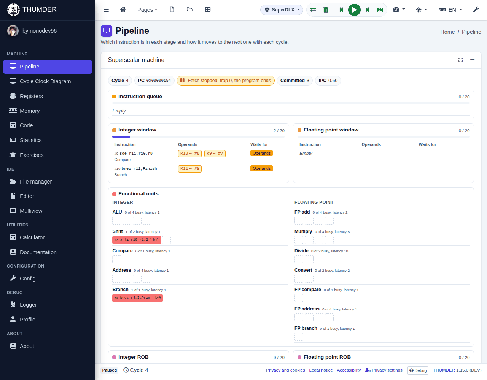

# The views

Each view shows the machine from one angle. They are in the **Machine** group of the side menu and all of them update with each cycle, so you can switch between them while you simulate.

| View | To see |
| :-- | :-- |
| [Pipeline](#pipeline) | Which instruction is in each stage and what each stage does |
| [Cycle Clock Diagram](#cycle-clock-diagram) | The history of each instruction and why it stalled |
| [Registers](#registers) | The control, integer and floating point registers |
| [Memory](#memory) | Each word of the memory |
| [Code](#code) | The machine code and what each instruction does |
| [Statistics](#statistics) | Cycles, CPI and where the time goes |
| [Datapath](#datapath) | Where the data goes in this cycle |
| [Multiview](#multiview) | Several views at once |

Each card has buttons to **maximise** it (it fills the window) and **collapse** it. Most also have an explanation at the bottom, which unfolds.

## Pipeline

The five stages of DLX (IF, ID, EX, MEM and WB) with the instruction in each one, and the floating point units (faddEX, fmultEX and fdivEX) with their number and their cycles. With each cycle, the instructions move to their next stage.

At the bottom, **Explanation of the cycle** tells what each stage does in this cycle and which values it moves: the IR and the PC in IF, the operands read in ID, the result of the ALU, the data of the memory and the register written. Forwarding is pointed out.

With **SuperDLX**, this view shows the superscalar machine: the instruction queue, the windows with the operands each instruction waits for, the functional units, the two ROBs, the load and store buffers, the renamed registers and the BTB.

## Cycle Clock Diagram

One row per instruction and one column per cycle, with the stage of each instruction in each cycle. Green arrows are forwarding, and red ones go from the instruction that causes a stall to the one that waits.

- **Stalls** are striped, with their kind: `R-Stall` (a data is missing), `W-Stall` (two instructions write the same register), `S-Stall` (no free unit), `T-Stall` (a trap waits for the pipeline to empty) and `Stall` (two instructions want MEM at once). `Aborted` is an instruction squashed by a branch.
- **Click a cell** to know what happens in it: which register is missing, which instruction computes it and whether forwarding would have avoided it. The **Previous stall** and **Next stall** buttons jump from one stall to another.
- **Moving around**: drag with the mouse or a finger; zoom with <kbd>Ctrl</kbd> and the wheel or with two fingers. With the focus on the diagram, the arrows scroll it, <kbd>+</kbd> and <kbd>-</kbd> zoom, <kbd>0</kbd> goes back to the initial size, <kbd>Home</kbd> goes to the start and <kbd>End</kbd> to the last cycle.
- **Export**: as an image (SVG with the whole history, or PNG of what is visible) or as a table (CSV). **Show as a table** shows it as a text table.

The diagram keeps the last 2,000 cycles (up to 100,000, in the settings). With SuperDLX, each cell says what the instruction does: fetched, in the queue, decoded, waiting in the window, in its unit, in memory, result written, waiting in the ROB, committed or squashed.

## Registers

Four tabs: **Control** (PC, IR, A, B, the result of the ALU, FPSR, DMAR, SDR, LDR...), **Integer** (R0 to R31), **Floating point** (F0 to F31) and **Double** (the pairs F0-F1, F2-F3...). The values are shown in hexadecimal, binary and other representations. What changed in the last cycle is highlighted.

To change a register, press its name (it has a pencil). Each control register explains what it holds.

## Memory

Each word of the memory, from address 0. **Show as** chooses how it is read: bytes, half words, words, ASCII, float, double or instruction code. What the last cycle reads or writes is highlighted.

To change a data, press its address (it has a pencil): you choose the type (byte, half word, word, float or double) and the value, and you can go to a label of the program. DLX is big-endian: the byte at the lowest address is the most significant.

## Code

The program as it is in memory: the address of each instruction, its code in hexadecimal, the instruction and the stage it is in. Press the description of an instruction to see what it does, the fields of its code and what happens in each stage of the pipeline. With SuperDLX, the stage is the state of the instruction.

## Statistics

| Tab | What it counts |
| :-- | :-- |
| **Summary** | Cycles, instructions executed, CPI and where the cycles go |
| **Stalls** | Each kind of stall, how many cycles it costs and how to reduce it |
| **Instructions** | How many of each kind: loads, stores, branches, floating point, traps |
| **With and without forwarding** | The same program run both ways, to see how much it saves |

The statistics download as CSV. With SuperDLX there are others: IPC, cycles by the instructions they commit, why each stage stops, branch prediction, the use of each unit and the same program in DLX and in SuperDLX.

## Datapath

The path of the data in the current cycle: the PC, the instruction memory, the register file, the ALU, the data memory, the registers between stages (IF/ID, ID/EX, EX/MEM and MEM/WB) and the forwarding. The wires used light up with the colour of their stage, and each register between stages shows what it captures with the clock.

It only exists for DLX: with SuperDLX, the machine is in the pipeline view.

## Multiview

Several views at once, in two columns, to follow the simulation from every angle.

- Drag a window by its handle to move it.
- Float it as a **window** to put it over the others; it moves by its title and resizes from its edges.
- On a phone, choose the views with the chips at the top.

Which windows appear and in which column is chosen in the [settings](configuracion.en.md).

## Other tools

- **Calculator** (**Utilities** group): converts between binary, hexadecimal, decimal and IEEE 754 floating point.
- **Logger** (**Debug** group): all the messages of the simulation, to filter, copy or download them.
