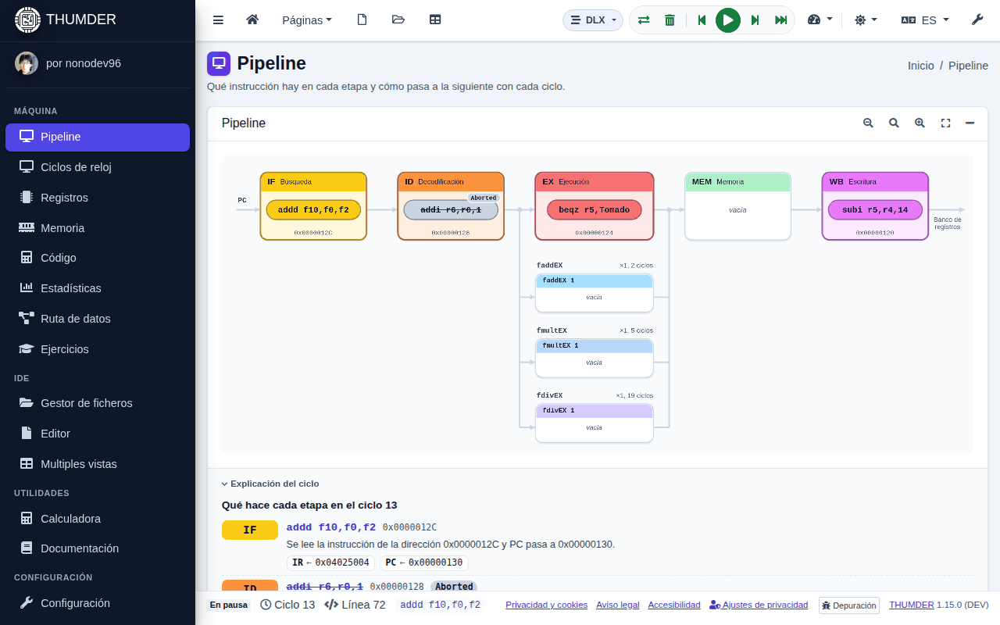
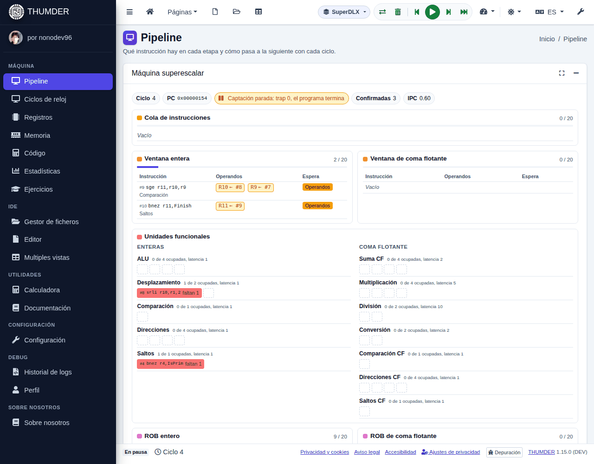
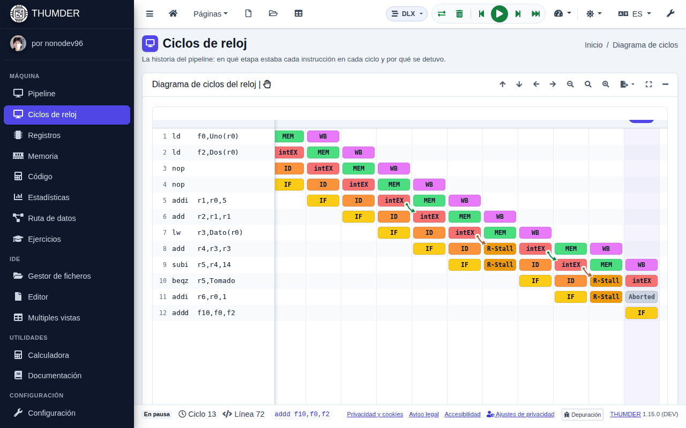
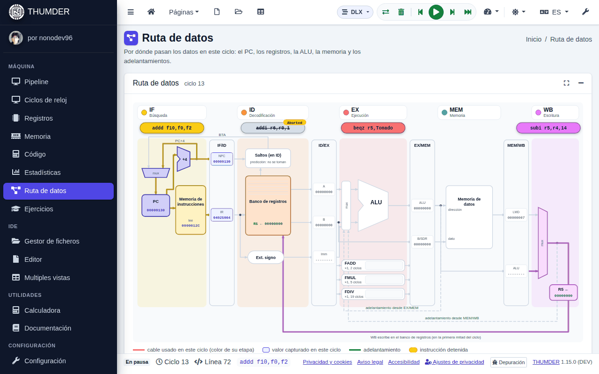

# Las vistas

Cada vista enseña la máquina desde un ángulo. Están en el grupo **Máquina** del menú lateral y todas se actualizan con cada ciclo, así que puedes cambiar de una a otra mientras simulas.

| Vista | Para ver |
| :-- | :-- |
| [Pipeline](#pipeline) | Qué instrucción hay en cada etapa y qué hace cada etapa |
| [Ciclos de reloj](#ciclos-de-reloj) | La historia de cada instrucción y por qué se detuvo |
| [Registros](#registros) | Los registros de control, enteros y de coma flotante |
| [Memoria](#memoria) | Cada palabra de la memoria |
| [Código](#código) | El código máquina y qué hace cada instrucción |
| [Estadísticas](#estadísticas) | Ciclos, CPI y en qué se pierde el tiempo |
| [Ruta de datos](#ruta-de-datos) | Por dónde pasan los datos en este ciclo |
| [Multiples vistas](#multiples-vistas) | Varias vistas a la vez |

Cada tarjeta tiene botones para **maximizarla** (ocupa toda la ventana) y **plegarla**. La mayoría tiene además una explicación al pie, que se despliega.

## Pipeline

Las cinco etapas de DLX (IF, ID, EX, MEM y WB) con la instrucción que hay en cada una, y las unidades de coma flotante (faddEX, fmultEX y fdivEX) con su número y sus ciclos. Con cada ciclo, las instrucciones pasan a su etapa siguiente.

Al pie, **Explicación del ciclo** cuenta qué hace cada etapa en este ciclo y qué valores mueve: el IR y el PC en IF, los operandos que se leen en ID, el resultado de la ALU, el dato de la memoria y el registro que se escribe. Los adelantamientos se señalan.

Con **SuperDLX**, esta vista enseña la máquina superescalar: la cola de instrucciones, las ventanas con los operandos que espera cada instrucción, las unidades funcionales, los dos ROB, los buffers de cargas y almacenamientos, los registros renombrados y la BTB.

## Ciclos de reloj

Una fila por instrucción y una columna por ciclo, con la etapa de cada instrucción en cada ciclo. Las flechas verdes son adelantamientos, y las rojas van de la instrucción que causa una detención a la que espera.

- **Las detenciones** salen rayadas, con su tipo: `R-Stall` (falta un dato), `W-Stall` (dos instrucciones escriben el mismo registro), `S-Stall` (no hay una unidad libre), `T-Stall` (un trap espera a que se vacíe el pipeline) y `Stall` (dos instrucciones quieren MEM a la vez). `Aborted` es una instrucción anulada por un salto.
- **Haz clic en una celda** para saber qué pasa en ella: qué registro falta, qué instrucción lo calcula y si el adelantamiento lo habría evitado. Los botones **Atasco anterior** y **Atasco siguiente** saltan de una detención a otra.
- **Moverse**: arrastra con el ratón o con un dedo; amplía con <kbd>Ctrl</kbd> y la rueda o con dos dedos. Con el foco en el diagrama, las flechas lo desplazan, <kbd>+</kbd> y <kbd>-</kbd> lo amplían, <kbd>0</kbd> vuelve al tamaño inicial, <kbd>Inicio</kbd> va al principio y <kbd>Fin</kbd>, al último ciclo.
- **Exportar**: como imagen (SVG con todo el historial, o PNG de lo que se ve) o como tabla (CSV). **Ver como tabla** lo enseña como una tabla de texto.

El diagrama guarda los últimos 2.000 ciclos (hasta 100.000, en la configuración). Con SuperDLX, cada celda dice qué hace la instrucción: captada, en la cola, decodificada, esperando en la ventana, en su unidad, en memoria, resultado escrito, esperando en el ROB, confirmada o anulada.

## Registros

Cuatro pestañas: **Control** (PC, IR, A, B, el resultado de la ALU, FPSR, DMAR, SDR, LDR...), **Enteros** (R0 a R31), **Coma flotante** (F0 a F31) y **Dobles** (los pares F0-F1, F2-F3...). Los valores se ven en hexadecimal, binario y otras representaciones. Lo que ha cambiado en el último ciclo se resalta.

Para cambiar un registro, pulsa su nombre (lleva un lápiz). Cada registro de control explica qué guarda.

## Memoria

Cada palabra de la memoria, desde la dirección 0. **Ver como** elige cómo se lee: bytes, medias palabras, palabras, ASCII, float, double o código de instrucción. Lo que lee o escribe el último ciclo se resalta.

Para cambiar un dato, pulsa su dirección (lleva un lápiz): eliges el tipo (byte, media palabra, palabra, float o double) y el valor, y puedes ir a una etiqueta del programa. DLX es *big-endian*: el byte de la dirección más baja es el más significativo.

## Código

El programa tal como está en memoria: la dirección de cada instrucción, su código en hexadecimal, la instrucción y la etapa en la que está. Pulsa la descripción de una instrucción para ver qué hace, los campos de su código y lo que pasa en cada etapa del pipeline. Con SuperDLX, la etapa es el estado de la instrucción.

## Estadísticas

| Pestaña | Qué cuenta |
| :-- | :-- |
| **Resumen** | Ciclos, instrucciones ejecutadas, CPI y en qué se van los ciclos |
| **Detenciones** | Cada tipo de detención, cuántos ciclos cuesta y cómo reducirla |
| **Instrucciones** | Cuántas de cada tipo: cargas, almacenamientos, saltos, coma flotante, traps |
| **Con y sin adelantamiento** | El mismo programa ejecutado de las dos formas, para ver cuánto ahorra |

Las estadísticas se descargan en CSV. Con SuperDLX hay otras: IPC, ciclos según las instrucciones que confirman, por qué se detiene cada etapa, la predicción de saltos, el uso de cada unidad y el mismo programa en DLX y en SuperDLX.

## Ruta de datos

El camino de los datos en el ciclo actual: el PC, la memoria de instrucciones, el banco de registros, la ALU, la memoria de datos, los registros entre etapas (IF/ID, ID/EX, EX/MEM y MEM/WB) y los adelantamientos. Los cables que se usan se iluminan con el color de su etapa, y cada registro entre etapas enseña lo que captura con el reloj.

Solo existe para DLX: con SuperDLX, la máquina está en la vista del pipeline.

## Multiples vistas

Varias vistas a la vez, en dos columnas, para seguir la simulación desde todos los ángulos.

- Arrastra una ventana por su asa para cambiarla de sitio.
- Sácala como **ventana flotante** para ponerla encima de las demás; se mueve por su título y cambia de tamaño desde los bordes.
- En el móvil, elige las vistas con los chips de arriba.

Qué ventanas salen y en qué columna se elige en la [configuración](configuracion.md).

## Otras herramientas

- **Calculadora** (grupo **Utilidades**): convierte entre binario, hexadecimal, decimal y coma flotante IEEE 754.
- **Historial de logs** (grupo **Debug**): todos los mensajes de la simulación, para filtrarlos, copiarlos o descargarlos.
