# Manual del simulador WinDLX

> **Origen**: *Material didáctico de Estructura y Tecnología de Computadores III. Cuaderno de prácticas*. Departamento de Informática y Automática, UNED. Curso académico 2000-2001.
> PDF original: <https://www.uv.es/varnau/Manual_Simulador_DLX.pdf> (descargado el 15 de octubre de 2026).
>
> Esta es una transcripción a Markdown. Se han quitado las cabeceras y los pies de página, y se han corregido erratas ortográficas evidentes. Las capturas se han extraído del PDF y están en [manual-simulador-dlx/](manual-simulador-dlx/). Las erratas técnicas del original se mantienen y se listan al final, en [Notas de esta versión](#notas-de-esta-versión).

## Índice

1. [Introducción al simulador WinDLX](#1-introducción-al-simulador-windlx)
2. [Descripción del entorno de simulación](#2-descripción-del-entorno-de-simulación)
3. [La estructura del pipeline de DLX](#3-la-estructura-del-pipeline-de-dlx)
4. [El lenguaje ensamblador del simulador WinDLX](#4-el-lenguaje-ensamblador-del-simulador-windlx)
5. [Traps](#5-traps)
6. [Ejecución de las instrucciones](#6-ejecución-de-las-instrucciones)
7. [Ejemplos de código DLX](#7-ejemplos-de-código-dlx)
8. [Práctica a realizar](#8-práctica-a-realizar)

---

## 1. Introducción al simulador WinDLX

WinDLX (Windows De LuXe simulator) es un simulador del pipeline del procesador DLX que se estudia en el libro «Arquitectura de Computadores: Una Aproximación Cuantitativa», 1.ª ed., Patterson y Hennessy.

Este software de simulación permite el procesamiento de programas escritos en ensamblador de DLX, mostrando toda la información relevante de la CPU (estado del pipeline, banco de registros, entrada/salida, memoria, estadísticas…). Su versatilidad posibilita la modificación de la estructura y tiempos de latencia del pipeline de la CPU y del tamaño de la memoria, así como del contenido de otros de sus componentes mientras se desarrolla la ejecución de un programa.

El software que se distribuye ha sido desarrollado en el Departamento de Diseño-VLSI de la Universidad Tecnológica de Viena, y funciona bajo el entorno Microsoft Windows 3.1 o una versión superior. La dirección de contacto es:

```text
Vienna University of Technology
Prof. Herbert Grünbacher
Department for VLSI-Design
Treitlstr. 3/2
A-1040 Vienna
FAX: (+43-1) 56 96 97
e-mail: maziar@vlsivie.twien.ac.at
```

En caso de no disponer de un disquete con el software y tener acceso a un ordenador con conexión a Internet, dos direcciones en donde se puede conseguir el simulador son:

- Servidor WWW del Dpto. de Informática y Automática. UNED: `http://www.dia.uned.es/asignaturas/etc3/etc3.html`
- Servidor FTP del Dept. for VLSI-Design. Universidad Tecnológica de Viena: `ftp://ftp.vlsivie.twien.ac.at`

### 1.1. Instalación

Todos los programas que conforman el software de simulación vienen comprimidos en un fichero autoexpandible denominado `WINDLX_D.EXE`. Para proceder a su instalación en el disco duro del ordenador siga los siguientes pasos:

1. Cree un directorio `WINDLX` en algún lugar del disco duro de su ordenador y sitúese en ese directorio.
2. Escriba el siguiente comando y ejecútelo: `A:\WINDLX_D.EXE`. Esto ocasionará que los archivos sean desempaquetados e instalados en el directorio actual del disco duro. Los archivos que deben haber sido creados son:

   | Archivo | Tamaño | Descripción |
   | :-- | --: | :-- |
   | `WINDLX.EXE` | 222.621 bytes | Simulador |
   | `WINDLX.HLP` | 92.389 bytes | Archivo de ayuda (idioma: inglés) |
   | `WDLXTUT.DOC` | 341.802 bytes | Breve tutorial (idioma: inglés, formato: Word) |
   | `FACT.S` | 1.279 bytes | Archivo ejemplo en ensamblador de DLX |
   | `GCM.S` | 1.395 bytes | Archivo ejemplo en ensamblador de DLX |
   | `INPUT.S` | 1.539 bytes | Archivo ejemplo en ensamblador de DLX |
   | `PRIM.S` | 1.308 bytes | Archivo ejemplo en ensamblador de DLX |
   | `README` | 2.139 bytes | Información sobre la instalación (ASCII) |
   | `README.TXT` | 2.777 bytes | Información sobre la instalación (Bloc de Notas) |

3. Si no está en Windows 3.1, entre y cree un nuevo grupo de programa denominado WinDLX. Dentro de él cree dos elementos del programa que correspondan a los ficheros `WINDLX.EXE` y `WINDLX.HLP`. Deberán aparecer dos iconos con el siguiente aspecto:

   

   Si dispone de Windows 95 no será necesaria la creación del grupo de programa. Simplemente abriendo la carpeta `WINDLX` visualizará los iconos de todos los ficheros que componen el software de simulación.

4. Haga doble clic sobre el icono del simulador para comenzar a realizar experimentos.

## 2. Descripción del entorno de simulación

Una vez abierta la aplicación podrá observar que aparece una ventana principal que a su vez contiene 6 ventanas inicialmente minimizadas, mostrando cada una de ellas diferentes aspectos relacionados con el procesador que se está simulando. El nombre de cada una de estas seis ventanas es:

- Registros (Register).
- Código (Code).
- Pipeline.
- Diagrama de Ciclos de Reloj (Clock Cycle Diagram).
- Estadísticas (Statistics).
- Puntos de ruptura (Breakpoints).

Una característica de estas ventanas es que no pueden cerrarse, por lo que permanecen abiertas o minimizadas durante todo el tiempo que se esté empleando el simulador. Junto con estas ventanas, existen otras que son creadas dinámicamente (hasta un máximo de 10) y que muestran el estado de la memoria asociada al procesador.

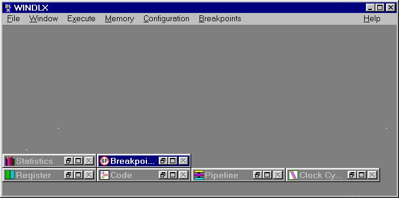

*Figura 1. Ventana principal de WinDLX*

La Barra de menús de WinDLX contiene 7 menús con los comandos necesarios para manejar las distintas posibilidades del simulador. En realidad el número de menús es superior, ya que el quinto comenzando por la izquierda cambia según sea la ventana que se encuentre activa en ese instante. Por lo tanto, tendremos los siguientes menús: File, Window, Execute, Memory, Configuration, Register, Code, Pipeline, Clock Cycle Diagram, Statistics, Breakpoints y Help.

### 2.1. Ventana y menú *Register*

Todos los valores de los registros disponibles en el procesador son visualizados en esta ventana (Figura 3). Los registros existentes son:

- **Especiales**. 16 registros. Se describirán más adelante.
- **Enteros o de propósito general**. 32 registros (R0 al R31) de 32 bits. El registro R0 es siempre 0.
- **Coma flotante**. Pueden considerarse como 32 registros de simple precisión (F0 al F31) o de doble precisión (64 bits), en cuyo caso sólo se dispone de 16 registros (D0, D2, D4, …, D30).

Para modificar el contenido de los registros basta con hacer doble clic sobre uno de ellos en la ventana de registros; tras esto aparecerá una ventana de diálogo en la que se puede introducir el nuevo valor. Los registros que pueden modificarse son los de **propósito general**, **coma flotante** y los especiales **PC** y **FPSR**. Valores legales para los registros enteros son expresiones enteras que pueden incluir nombres de registros (por ejemplo, `R19 * 20`), admitiéndose para los registros en coma flotante únicamente valores constantes (es decir, `R19 * 20` no sería validado, mientras que `12.9`, sí).

Formato de un registro de coma flotante en simple precisión:

| Bits | 0 a 7 | 8 a 15 | 16 a 23 | 24 a 31 |
| :-- | :-: | :-: | :-: | :-: |
| Contenido | Byte 0 | Byte 1 | Byte 2 | Byte 3 |

Formato de un registro de coma flotante en doble precisión:

| Bits | 0 a 7 | 8 a 15 | 16 a 23 | 24 a 31 |
| :-- | :-: | :-: | :-: | :-: |
| Contenido | Byte 0 | Byte 1 | Byte 2 | Byte 3 |
| **Bits** | **32 a 39** | **40 a 47** | **48 a 55** | **56 a 63** |
| Contenido | Byte 4 | Byte 5 | Byte 6 | Byte 7 |

*Figura 2. Formato de los registros de coma flotante*

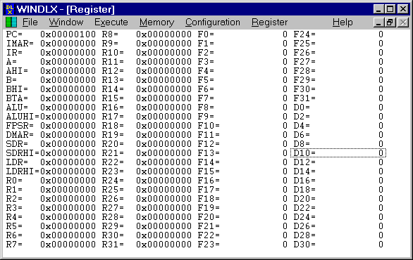

*Figura 3. Ventana de registros*

Los registros de propósito especial son los siguientes:

- **FPSR** (Floating-Point Status Register). Es un registro de estado de 1 bit de longitud, utilizado para comparaciones y excepciones de coma flotante. Todos los movimientos desde y hacia este registro se realizan a través de los registros de propósito general. Las comparaciones en punto flotante asignan el bit de este registro, estando disponibles instrucciones de salto que basan su resultado en el valor del bit (1 cierto, 0 falso).
- **PC** (Program Counter). Siempre contiene la dirección de la próxima instrucción que va a ser ejecutada. Los saltos y las bifurcaciones pueden cambiar el contenido del mismo.
- **IMAR** (Instruction Memory Address Register). Este registro es inicializado con el contenido del contador de programa en la etapa IF a causa de que está conectado con el sistema de memoria, mientras que el PC no.
- **IR** (Instruction Register). En la etapa IF es cargado con la próxima instrucción a ejecutarse.
- **A, B**. Son cargados en la etapa ID y sus valores son enviados a los operandos de la unidad aritmético lógica en la siguiente etapa, la EX. En WinDLX, además existen los pseudo-registros **AHI** y **BHI** que contienen los 32 bits superiores para valores en coma flotante de doble precisión.
- **BTA** (Branch Target Address). En la etapa ID, la dirección de salto/bifurcación es calculada y escrita en este registro (ver página 292 del texto base de la asignatura).
- **ALU** (Arithmetic Logical Unit). El resultado de una operación en la ALU es transferido a este registro. En WinDLX existe un pseudo-registro llamado **ALUHI** que contiene los 32 bits superiores para valores en coma flotante de doble precisión.
- **DMAR** (Data Memory Address Register). La dirección de memoria a la que se va a acceder es transferida a este registro en la etapa EX. En la etapa MEM, el acceso a la memoria para lectura o escritura es efectuado con el valor almacenado en este registro.
- **SDR** (Store Data Register). El dato que se va a escribir en memoria por medio de una instrucción es almacenado previamente en este registro. En WinDLX existe un pseudo-registro llamado **SDRHI** que contiene los 32 bits superiores para valores en coma flotante de doble precisión.
- **LDR** (Load Data Register). El dato que es leído de memoria se almacena en este registro. En WinDLX existe un pseudo-registro llamado **LDRHI** que contiene los 32 bits superiores para valores en coma flotante de doble precisión.

Los comandos situados en el menú *Register* permiten visualizar uno o varios subconjuntos de registros, así como especificar si el contenido de los registros se representa en decimal o hexadecimal. Los registros en punto flotante siempre se representan en forma decimal.

### 2.2. Ventana y menú *Code*

En la ventana *Code* son visualizadas, tanto en forma hexadecimal como desensambladas, las instrucciones de DLX que hay almacenadas en memoria junto con sus direcciones. Por otra parte, los puntos de ruptura (*breakpoints*) de cada instrucción son indicados con `Bxx`, siendo `xx` el tipo de punto de ruptura.

Cuando una instrucción está ejecutándose en una etapa determinada del pipeline, un color característico de cada etapa es utilizado como color de fondo para la instrucción. Junto con el color y a la derecha de la representación hexadecimal de la instrucción aparece una etiqueta indicando la etapa en que se encuentra (ver Figura 4).

Es posible recorrer toda la memoria existente utilizando las teclas de desplazamiento de páginas (RePág, AvPág, Inicio, Fin), las teclas de posición (←, ↑, →, ↓) o la barra de desplazamiento (lateral derecho de la ventana). Siempre que se ejecutan instrucciones del código ensamblador almacenado en la memoria, las procesadas en último lugar son las que se visualizan en la ventana.

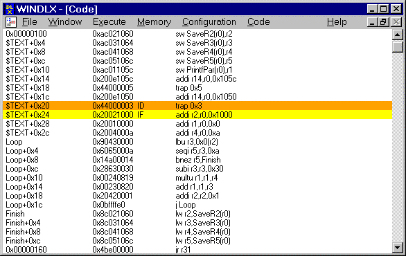

*Figura 4. Ventana de código*

Para obtener información detallada de las instrucciones que están en el pipeline se selecciona la instrucción con el cursor del ratón o con la tecla TAB y se pulsa ENTER, o se hace doble clic directamente sobre la instrucción. Tras esto aparecerá la ventana de información de la instrucción como se puede apreciar en la Figura 5 (más adelante se describirán con mayor detalle los contenidos de esta ventana). Para deseleccionar una instrucción pulse la tecla ESC.

En principio, para establecer y suprimir los puntos de ruptura desde la ventana *Code* es necesario seleccionar la instrucción tal y como se ha descrito y recurrir a los comandos del menú *Code*.

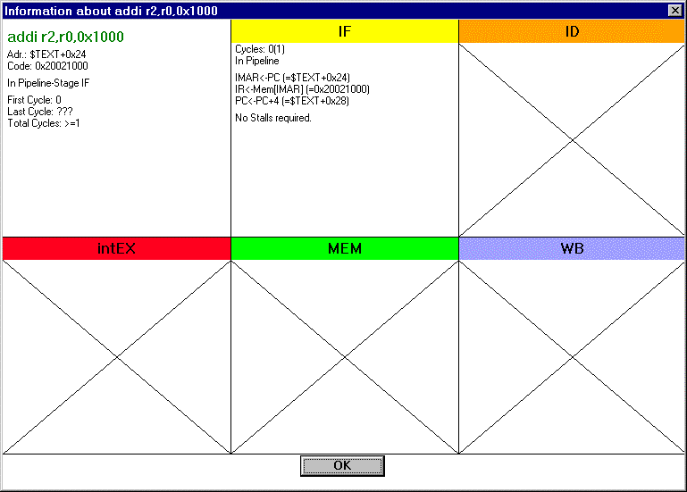

*Figura 5. Ventana de información de instrucción*

El menú *Code* contiene los siguientes comandos:

- **From Address**. Al activar este comando aparece una ventana de diálogo similar a la que se puede apreciar en la siguiente figura. Por medio de este comando es posible especificar la primera dirección de memoria que se comienza a visualizar en la ventana *Code*. El valor que se especifica puede ser cualquier expresión entera (se permiten operadores y símbolos).

  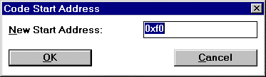

  *Figura 6. Ventana del comando From Address*

- **Set Breakpoint**. Al activar este comando aparece una ventana de diálogo en la que es posible asignar un punto de ruptura a la instrucción seleccionada (máximo 20 puntos de ruptura).

  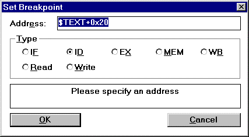

  *Figura 7. Ventana de diálogo del comando Set Breakpoint*

- **Delete Breakpoint**. Permite eliminar el punto de ruptura asignado a la instrucción seleccionada.

### 2.3. Ventana y menú *Pipeline*

En la ventana *Pipeline* se visualizan las etapas por las que pasan las instrucciones dentro de la estructura del pipeline del procesador. Si la ventana tiene un tamaño suficientemente grande, las cajas coloreadas que representan las etapas visualizan la instrucción que en ese preciso instante se está ejecutando.

Haciendo doble clic con el puntero del ratón sobre las cajas, es posible obtener información detallada sobre las instrucciones que en ese instante se están ejecutando en cada etapa. La información se visualiza por medio de la ventana de información de la instrucción (Figura 8).

El menú *Pipeline* contiene un único ítem denominado **Display Floating point stages**. Su utilidad es la de mostrar en la ventana *Pipeline* las etapas en coma flotante existentes o, por el contrario, visualizar sólo las cinco etapas básicas del pipeline del DLX (en la Figura 8 se puede apreciar el aspecto de la ventana *Pipeline* con la opción *Display Floating point stages* activa).

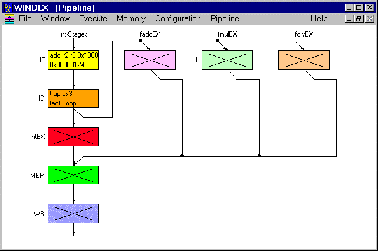

*Figura 8. Ventana Pipeline*

### 2.4. Ventana y menú *Clock Cycle Diagram*

En esta ventana se visualizan las operaciones que se realizan en cada ciclo de reloj y en cada etapa. Como puede apreciarse en la Figura 9, cada columna representa el estado del pipeline en un ciclo de reloj. El estado actual del pipeline es representado en color gris en la columna situada en el extremo derecho de la ventana. Al igual que en la ventana *Code*, es posible obtener más información sobre una instrucción haciendo doble clic sobre ella.

Las detenciones (*stalls*) son representadas en cajas coloreadas en el color asociado a la etapa detenida. La etiqueta que aparece en el interior de las cajas proporciona más información sobre el tipo de detención:

- **R-Stall** (Read After Write Stall). Una flecha en color rojo señala la instrucción que está produciendo la detención por causa de este tipo de riesgo de datos.
- **T-Stall** (Trap Stall). Esta detención sólo se produce ante una instrucción de trap. La instrucción de trap permanece en la etapa IF hasta que no queden más instrucciones en el interior del pipeline.
- **W-Stall** (Write After Write Stall). Una flecha roja señala la instrucción que causa la detención. Este riesgo sólo se presenta en pipelines que escriben en los registros o en memoria en varias etapas. El pipeline de DLX escribe sólo los registros en la etapa WB, evitando esta clase de riesgos para las instrucciones enteras, pero no con las operaciones en coma flotante, como veremos más adelante.
- **S-Stall** (Structural Stall). No existen suficientes recursos hardware para ejecutar la instrucción.
- **Stall**. Cuando una instrucción de coma flotante está en la etapa MEM, la próxima instrucción será detenida en la etapa intEX etiquetándola con la palabra *Stall*.

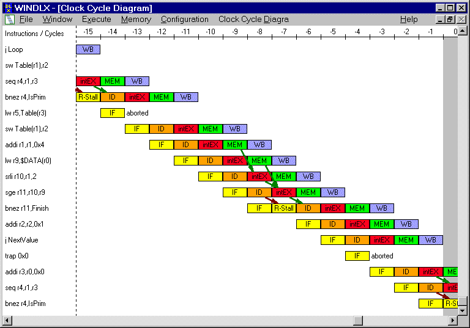

*Figura 7. Diagrama de ciclos de reloj*

El menú *Clock Cycle Diagram* contiene los siguientes ítems:

- **Display Forwarding**. Si esta opción está activa, tanto la etapa origen como la etapa destino del adelantamiento de datos son unidas con una flecha verde en el diagrama de ciclos de reloj.
- **Display Cause of Stalls**. Si esta opción está activa, la instrucción que causa una detención por riesgos de datos (RAW o WAW) es marcada con una flecha roja.
- **Delete History**. Su activación provoca que el historial de instrucciones ejecutadas que aparecen en el diagrama de ciclos de reloj sea eliminado. Estas instrucciones no podrán volver a ser visualizadas en el diagrama.
- **Set History Length…** Su ejecución provoca la aparición de una ventana de diálogo (Figura 8) en la que se puede especificar la longitud del historial entre 0 y 100. Un historial de longitud 0 implica que sólo se visualiza en el diagrama la instrucción que está siendo ejecutada en ese momento.

  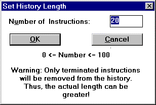

  *Figura 8. Ventana del comando Set History Length*

### 2.5. Ventana y menú *Statistics*

La ventana *Statistics* es utilizada para visualizar estadísticas sobre la simulación que está siendo realizada. Los datos son organizados en los siguientes grupos:

- **Total**. Este grupo siempre es visualizado y contiene el número de ciclos consumidos, el número de instrucciones ejecutadas que han pasado por la etapa ID y el total de instrucciones que están siendo ejecutadas en el pipeline en ese instante.
- **Hardware configuration**. Este grupo proporciona información referente al tamaño de la memoria, el total de unidades de proceso en coma flotante y los ciclos que se consumen en la realización de operaciones, y si está o no habilitado el mecanismo de adelantamiento (comando *Enable Forwarding* del menú *Configuration*).
- **Stalls**. Proporciona valores absolutos y relativos sobre:
  - El número de riesgos RAW. En caso de que el adelantamiento esté habilitado y la opción *Detail Info* del menú *Statistics* esté activa, el número de detenciones se dividirá en:
    - Número de riesgos RAW provocados por una instrucción de carga.
    - Número de riesgos RAW provocados por una instrucción de salto o bifurcación.
    - Número de riesgos RAW provocados por una instrucción de coma flotante.
  - Número de riesgos WAW.
  - Número de detenciones estructurales antes de instrucciones de coma flotante.
  - Número de detenciones de control. Esta cifra es equivalente al número de saltos condicionales efectivos debido a que el procesador DLX simulado aplica la política de predecir-no-efectivo. De esta forma, los saltos no efectivos no producen detenciones en el pipeline mientras que los efectivos ocasionan una detención de 1 ciclo.
  - Número de detenciones causadas por una instrucción de trap.
- **Conditional Branches**. Detalla el número de saltos condicionales. Si la opción *Detail Info* está activada se amplía la información mostrando los saltos efectivos y los no efectivos.
- **Load/Store-Instructions**. Total de instrucciones de carga y almacenamiento ejecutadas. Si la opción *Detail Info* está activa la información es dividida en cargas y almacenamientos.
- **Floating point stages instructions**. Proporciona el total de instrucciones ejecutadas en las etapas de coma flotante (faddEX, fmulEX, fdivEX). Si la opción *Detail Info* está activa la información es dividida en:
  - Total de instrucciones ejecutadas en la etapa faddEX-Stage.
  - Total de instrucciones ejecutadas en la etapa fmulEX-Stage.
  - Total de instrucciones ejecutadas en la etapa fdivEX-Stage.
- **Traps**. Total de traps realizados.

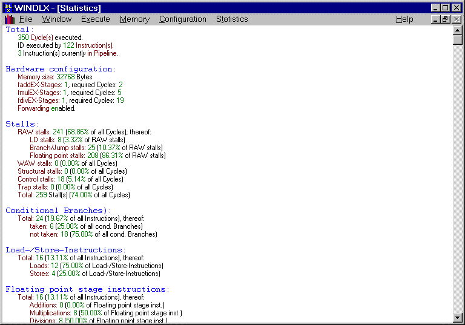

*Figura 9. Diagrama de ciclos de reloj* (sic: es la ventana de estadísticas)

El menú *Statistics* contiene varios comandos para configurar la información que aparece en la ventana. Uno de ellos, el comando **Display**, es a su vez un menú desplegable que ofrece las siguientes opciones: Hardware, Stalls, Conditional Branches, Load/Store-Instructions, Floating point stages instructions, Traps y All. La activación/desactivación de una de estas opciones origina el despliegue o no del correspondiente grupo de datos en la ventana *Statistics*.

Otros comandos del menú son **Detail Info** y **Reset**. Este último realiza una inicialización de todos los valores de los grupos de datos que aparecen en la ventana *Statistics*.

### 2.6. Ventana y menú *Breakpoints*

El contenido de esta ventana es el conjunto de instrucciones que tienen puntos de ruptura asignados (el número máximo de puntos de ruptura que es posible tener es de 20). Por medio de los comandos del menú propio de esta ventana es posible visualizar, modificar o eliminar los puntos de ruptura ya existentes. Como ya se describió, otra posibilidad de asignar o eliminar puntos de ruptura es a través de la ventana *Code*.

Para modificar un punto de ruptura sin recurrir al menú basta con hacer doble clic sobre alguna de las instrucciones que aparecen en la ventana. Los comandos que ofrece el menú son:

- **Set…** Tras activar el comando se visualiza una ventana de diálogo (Figura 10) en la que es posible fijar un punto de ruptura con los siguientes datos:
  - **Address**. La dirección puede ser una expresión entera formada por valores, operadores y símbolos. El resultado de evaluar la expresión debe ser múltiplo de 4 (de lo contrario la dirección es convertida al siguiente múltiplo de 4).
  - **Type**. El tipo de punto de ruptura indica que la instrucción almacenada en la dirección *Address* será abortada cuando alcance esa etapa del pipeline. Un punto de ruptura del tipo *Read* se produce cuando se efectúa la lectura del dato (o parte de él) almacenado en la dirección *Address* (por ejemplo, por medio de una instrucción de carga o de *fetch*). Análogamente ocurre con el tipo *Write*: escritura del dato especificado por la dirección *Address* (por ejemplo, por medio de una instrucción de almacenamiento o de ciertos traps).
- **Delete**. Elimina el punto de ruptura que está seleccionado.
- **Delete All**.
- **Change…** Similar a la acción de doble clic sobre la instrucción.

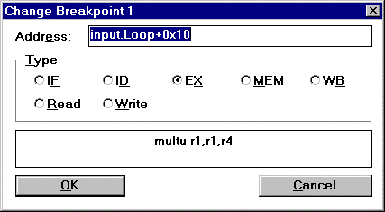

*Figura 10. Ventana de diálogo del comando Change…*

### 2.7. La Barra de menús

Junto con los menús asociados a las seis ventanas de trabajo del entorno de simulación existen otros seis menús: File, Window, Execution, Memory, Configuration y Help.

#### 2.7.1. Menú *File*

Dispone de las siguientes opciones:

- **Reset DLX**. Su selección implica la realización de las siguientes operaciones:
  - El pipeline es limpiado.
  - Las estadísticas son inicializadas.
  - Todos los registros son inicializados (PC con el valor `$TEXT` y los restantes con cero).
  - Todo el historial de las instrucciones ejecutadas es eliminado.
  - Todos los archivos abiertos son cerrados.
  - La redirección DLX-I/O es cancelada.
  - El contenido de la ventana DLX-I/O es borrado.

  El contenido de la memoria y de los símbolos definidos permanece inalterado.

- **Reset All**. Junto con todas las tareas efectuadas por el comando *Reset DLX*, la memoria es inicializada a ceros y todos los símbolos son eliminados. Los símbolos `$TEXT` y `$DATA` permanecen inalterados por estar fijados en la configuración del simulador.
- **Load Code or Data**. La selección de esta opción ocasiona la aparición de una ventana de diálogo similar a la que se puede apreciar en la Figura 11. Es posible seleccionar un número arbitrario de ficheros con código DLX siempre que tengan la extensión `.s` mediante la pulsación del botón *Select*. Los ficheros seleccionados aparecerán en el campo situado en la zona inferior de la ventana. Tras la selección de los ficheros y para proceder a la carga y ensamblado de los mismos en la memoria del simulador hay que pulsar el botón *Load*. Si se producen errores, estos se visualizan en una caja de diálogo alternativa y todos los datos escritos en memoria serán considerados inválidos.

  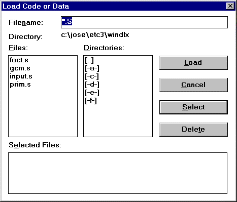

  *Figura 11. Ventana de diálogo del comando Load Code or Data*

  La posibilidad de cargar múltiples módulos al mismo tiempo permite definir símbolos globales que pueden ser utilizados en varios módulos. Por otra parte, es posible cargar módulos con independencia del orden.

- **Quit WINDLX**. Antes de abandonar el simulador, aparecerá una caja de diálogo en la que se contempla la posibilidad de almacenar la configuración actual del entorno (Figura 12).

  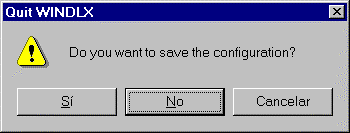

  *Figura 12. Cuadro de diálogo asociado al comando Quit WinDLX*

#### 2.7.2. El menú *Window*

Los comandos contenidos en este menú son los típicos de cualquier aplicación Windows, por lo que no se entrará en mayor detalle. Debajo de estos comandos (Cascade, Tile, Arrange Icons) se encuentran las opciones para visualizar o seleccionar alguna de las seis ventanas de trabajo descritas anteriormente.

#### 2.7.3. El menú *Execute*

En este menú se encuentran los comandos necesarios para ejecutar el código ensamblado en la memoria y visualizar la ventana de entrada/salida:

- **Single Cycle**. Su activación ocasiona que un único ciclo del procesador DLX sea simulado. Siempre que suceda una entrada o salida durante este ciclo la ventana DLX-I/O será visualizada. Si durante la simulación ocurre un error, se ejecuta un trap indefinido o un punto de ruptura es alcanzado, una ventana de mensajes mostrará información detallada sobre el estado de la instrucción causante del mensaje.
- **Multiple Cycles**. Esta opción permite fijar en una ventana de diálogo (Figura 13) el número de ciclos que van a ser simulados. Al igual que ocurre con las opciones *Run* o *Run to…*, la ventana DLX-I/O es visualizada. La simulación será abortada cuando:
  - El número indicado de ciclos sea simulado.
  - Se pulse el botón *Cancel* que aparece en la ventana DLX-I/O.
  - Ocurra un error.
  - Se alcance un punto de ruptura.
  - Un trap indefinido sea procesado.

  Para los tres últimos casos, se visualizará una ventana de mensajes.

  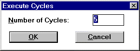

  *Figura 13. Ventana de diálogo del comando Multiple Cycles*

- **Run**. Si se activa este comando, la simulación del procesador DLX continuará hasta que:
  - Se detenga por medio del botón *Cancel* situado en la ventana DLX-I/O.
  - Suceda un error.
  - Se alcance un punto de ruptura.
  - Se procese un trap indefinido.

  En todos estos casos se visualizará una ventana de mensajes.

- **Run to…** Es similar a *Run*, excepto que permite asignar un punto de ruptura temporal por medio de una ventana de diálogo. Este punto de ruptura sólo es válido durante el proceso de ejecución de la simulación, pero por defecto es almacenado para la próxima vez que se utilice este comando.
- **Display DLX-I/O**. La activación de este comando provoca la visualización de la ventana DLX-I/O aunque la simulación no esté funcionando.

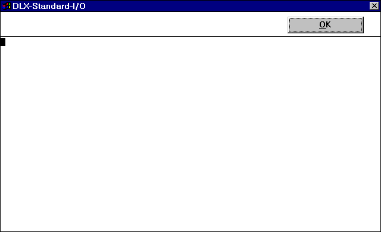

*Figura 14. Ventana DLX-I/O*

##### 2.7.3.1. Ventana DLX-I/O

Como ya hemos visto, esta ventana es visualizada cuando:

- El usuario ha activado el comando *Display DLX-I/O* situado en el menú *Execute*.
- Un trap es ejecutado en un único paso y la salida de datos y errores no ha sido redireccionada a un archivo. Esto obliga a visualizar toda la información de salida en la ventana DLX-I/O.
- Un trap es ejecutado en un único paso y una introducción de datos es necesaria, no estando la entrada de datos redireccionada desde un fichero. Como datos de entrada es posible escribir cualquier cadena de caracteres, terminando la entrada de datos con la pulsación de la tecla ENTER.
- Más de un paso es ejecutado (comando *Run to…* del menú *Execute*). Esto permite abortar la simulación presionando el botón *Cancel*. Si algún trap procesado requiere de una entrada vía teclado, un mensaje será visualizado en la ventana.

La ventana DLX-I/O dispone de un menú denominado *DLX-Standard-I/O* que se obtiene al pulsar en la esquina superior izquierda de la ventana. Contiene los siguientes comandos:

- **Delete Window**. La información que aparece en la ventana DLX-I/O es borrada, situándose el cursor en la esquina superior izquierda.
- **Redirect to File**. Esta opción tiene un submenú con las siguientes posibilidades:
  - **Standard input**. Es la entrada de datos hacia el programa que se está procesando.
  - **Standard output**. Es la salida de datos producidos por la aplicación.
  - **Standard error**. Es la salida de errores producidos durante el proceso de simulación.

  Es posible redireccionar cualquiera de estas entradas y salidas de datos y errores a un archivo mediante una ventana de diálogo (Figura 15). Las extensiones que por defecto se colocan a los nombres de los archivos de entrada y salida son:
  - `IN` para la entrada estándar de datos.
  - `OUT` para la salida estándar de datos.
  - `ERR` para la salida estándar de errores.

  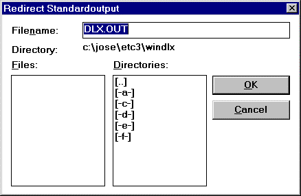

  *Figura 15. Ventana de diálogo para la redirección de la salida estándar*

  Siempre que reinicialice el procesador, todas las redirecciones serán anuladas.

- **Redirect to Window**. Esta opción realiza la función contraria que el comando anterior, es decir, obliga a que una de las tres vías de datos sea redireccionada hacia la ventana anulando la redirección a un archivo. Las opciones del comando son:
  - Standard input.
  - Standard output.
  - Standard error.

#### 2.7.4. Menú *Memory*

Este menú proporciona comandos para crear ventanas de memoria, cambiar el contenido de las posiciones de memoria y manipular símbolos. Las órdenes del menú son:

- **Display…** Permite la creación de hasta 10 ventanas en las que se visualiza el contenido de las posiciones de memoria en varios tipos y formatos. La activación de este comando provoca la aparición de una ventana de diálogo (Figura 16) en la que se puede seleccionar el tipo, formato y la dirección de comienzo de la sección de memoria que se desea visualizar:

  | Tipo | Formato |
  | :-- | :-- |
  | Byte (8 bits) | hexadecimal, decimal o carácter |
  | Half-word (16 bits) | hexadecimal o decimal |
  | Word | hexadecimal o decimal |
  | Single floating point (32 bits) | decimal |
  | Double floating point (64 bits) | decimal |

  La dirección de memoria puede ser una expresión entera formada por valores, operadores y símbolos. Las opciones que se seleccionen en la ventana de diálogo serán almacenadas y utilizadas como valores por defecto la próxima vez que se active este comando del menú.

  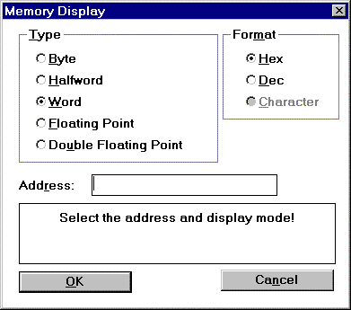

  *Figura 16. Ventana del comando Display… del menú Memory*

- **Change…** Mediante la activación de este comando se obtiene una ventana de diálogo (Figura 17) desde la que es posible cambiar o visualizar el contenido de una posición de memoria. Es posible seleccionar el formato del dato que va a ser visualizado en la ventana.

  Para modificar el contenido de una posición de memoria, se selecciona el tipo y formato de visualización, se introduce una expresión entera para especificar la dirección y se presiona el botón *Set*. El nuevo valor será almacenado en la posición de memoria especificada sustituyendo el valor anterior.

  Los botones *Next* y *Previous* muestran el contenido de las posiciones de memoria inmediatamente anterior y posterior a la dirección especificada. La dirección es incrementada o decrementada en tantos bytes como lleve asociado el tipo de formato seleccionado.

  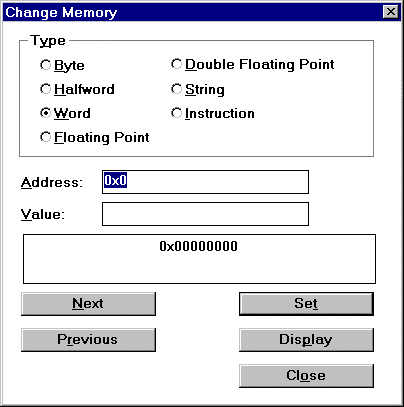

  *Figura 17. Ventana de diálogo del comando Change… del menú Memory*

- **Symbols…** Este comando permite la manipulación de símbolos a través de la ventana de diálogo de la Figura 18. Dentro de la ventana y en el cuadro *Symbol List* son mostrados todos los símbolos, clasificados por el nombre y valor.

  Para definir símbolos globales, se introduce el nombre y valor del nuevo símbolo (una expresión entera) y se presiona el botón *New*.

  Para cambiar el valor de un símbolo existente se selecciona el símbolo, se introduce un valor en el campo *Value* y se pulsa el botón *Change*.

  Para eliminar un símbolo, se selecciona el símbolo de la lista y se presiona el botón *Delete*.

  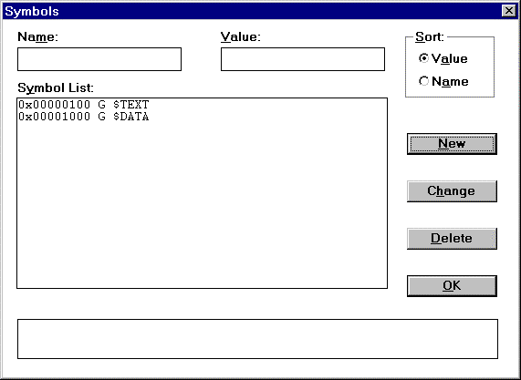

  *Figura 18. Ventana de diálogo del comando Symbol… del menú Memory*

Siempre que se dispone de una ventana de memoria activa, se añade un nuevo ítem a la Barra de menús denominado *Memory Display* con comandos que se aplican sobre la ventana de memoria activa. Estos comandos son:

- **Change…** Es similar al comando *Change…* del menú *Memory*.
- **Exit**. Cierra la ventana de memoria activa.

#### 2.7.5. Menú *Configuration*

Los comandos para la configuración del procesador DLX situados dentro de este menú son los siguientes:

- **Floating point stages…** Por medio de este comando es posible determinar el número de unidades en punto flotante (1..8) o sus latencias (1..50 ciclos). La modificación de estos valores implica la inmediata reinicialización del procesador.

  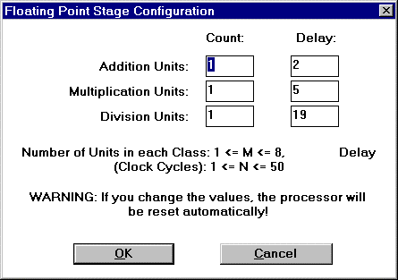

  *Figura 19. Ventana de diálogo del comando Floating Point Stages… del menú Configuration*

- **Memory size…** Permite modificar el tamaño de la memoria disponible por el procesador. Teóricamente, el tamaño de la memoria puede estar entre 512 bytes (`0x200`) y 16 Megabytes (`0x1000000`). En la práctica, el tamaño está limitado por la configuración del entorno Windows.

  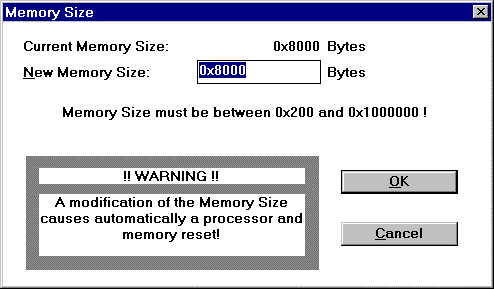

  *Figura 20. Ventana de diálogo del comando Memory size… del menú Configuration*

- **Symbolic Addresses**. Si se habilita este comando, las direcciones de memoria serán visualizadas como «símbolo+desplazamiento». En caso contrario serán presentadas en hexadecimal.
- **Absolute Cycle Count**. Si se habilita este comando, los ciclos de reloj se cuentan desde 0, reinicializando el procesador y las estadísticas. De lo contrario, los ciclos de reloj son contados a partir del instante actual, es decir, el ciclo actual es el 0 y los previos son etiquetados como -1, -2, etc.
- **Enable Forwarding**. Permite activar o desactivar el mecanismo de adelantamiento de datos.
- **Load…** Mediante este comando es posible recuperar un fichero de configuración del procesador. Tras cargar la nueva configuración, el entorno WinDLX será reinicializado con los nuevos valores, pero los contenidos de la memoria y los símbolos permanecerán sin cambios.

  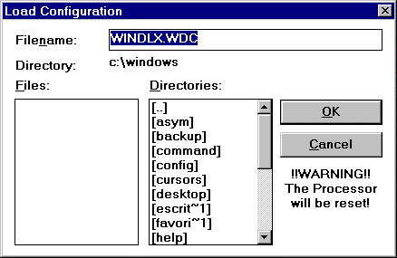

  *Figura 21. Ventana de diálogo del comando Load… del menú Configuration*

- **Save…** Permite almacenar la configuración actual del procesador en un archivo con la extensión `.WDC`. Por defecto, y si no se especifica otro, el nombre del archivo será `WINDLX.WDC`. Cuando se arranca WinDLX por primera vez, la configuración almacenada en el fichero `WINDLX.WDC` será recuperada automáticamente.

  El almacenamiento de la configuración puede efectuarse al finalizar la sesión de trabajo con el simulador (al salir aparece una ventana de diálogo preguntando esta cuestión) o, como ya hemos visto, mediante la activación de este comando.

#### 2.7.6. Menú *Help*

El menú *Help* contiene un conjunto de comandos que permite acceder al sistema de ayuda del entorno WinDLX. En cualquier instante se puede obtener información de ayuda presionando la tecla F1.

El sistema de ayuda está constituido por un manual de usuario y una descripción del procesador DLX y de su repertorio de instrucciones. Prácticamente toda la información contenida en el sistema de ayuda de WinDLX se ha traducido y trasladado a este manual con el fin de proporcionar al estudiante una pequeña guía en castellano del entorno de simulación, junto con las características más importantes del procesador DLX.

## 3. La estructura del pipeline de DLX

Como ya sabemos, la estructura del *pipeline* del procesador DLX está compuesta por cinco etapas. En el gráfico siguiente (Figura 22) se pueden apreciar junto con las etapas correspondientes a las operaciones en coma flotante.

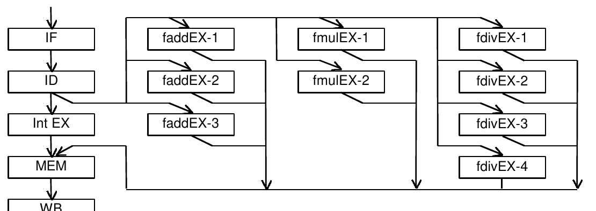

*Figura 22. Estructura del pipeline de DLX*

### 3.1. Etapa IF

Una instrucción es leída de memoria y almacenada en el registro de instrucciones, al mismo tiempo que el contador de programa se incrementa para apuntar a la siguiente instrucción.

### 3.2. Etapa ID

La instrucción leída en la etapa anterior es decodificada y los registros implicados en la instrucción son transferidos del banco de memoria y almacenados en los registros A y B. Los saltos condicionales son calculados en esta etapa con el fin de reducir los riesgos de control.

### 3.3. Etapas EX

En esta etapa, la unidad adecuada es seleccionada para que opere sobre los operandos ya preparados en el paso anterior. Las unidades de procesamiento implicadas en esta etapa pueden ser:

- **intEX** (1 unidad entera). Esta unidad realiza operaciones aritméticas enteras (excepto multiplicar y dividir) y calcula las direcciones efectivas de salto para las referencias a memoria y bifurcaciones.
- **faddEX** (hasta 8 unidades). Esta unidad efectúa sumas y restas en coma flotante tanto en simple como en doble precisión.
- **fmulEX** (hasta 8 unidades). Realiza multiplicaciones en simple y doble precisión en coma flotante y sobre números enteros con y sin signo.
- **fdivEX** (hasta 8 unidades). Realiza divisiones en simple y doble precisión en coma flotante y sobre números enteros con y sin signo.

### 3.4. Etapa MEM

Las únicas instrucciones activas en esta etapa son las cargas y almacenamientos. Si la instrucción es una carga los datos son leídos de la memoria, y si es un almacenamiento los datos son transferidos a la memoria. En ambos casos, las direcciones utilizadas han sido calculadas en la etapa anterior.

### 3.5. Etapa WB

El resultado obtenido de las etapas anteriores es transferido al banco de registros. La operación de escritura en los registros se efectúa durante la primera mitad del ciclo, de forma que la instrucción que se encuentra en ese instante en la etapa ID puede leer el registro en la segunda mitad del ciclo de reloj, eliminando la necesidad de adelantar los resultados a esa instrucción.

## 4. El lenguaje ensamblador del simulador WinDLX

El entorno de simulación WinDLX permite cargar uno o más ficheros con código ensamblador, efectuándose la carga de los mismos siempre en orden alfabético. Junto con las instrucciones DLX, el ensamblador que soporta el simulador dispone de varias directivas que afectan a la forma de situar los datos e instrucciones en memoria.

### 4.1. Repertorio de instrucciones del DLX

El repertorio de instrucciones del procesador DLX consta de cuatro clases de instrucciones:

- Instrucciones de transferencia de datos.
- Instrucciones lógicas y aritméticas.
- Instrucciones de control.
- Instrucciones de coma flotante.

con tres tipos de formatos: I, R y J (consultar el libro de texto de la asignatura).

Todas las instrucciones son de 32 bits de longitud con un código de operación de 6 bits.

> **Notación** (nota de esta versión, siguiendo la del original):
>
> - `←ₙ` es una transferencia de `n` bits.
> - `xⁿ` repite `n` veces el bit o el valor `x`.
> - `x₀` es el bit de signo (el bit 0, el más significativo).
> - `||` concatena.
> - `M{dir}` es la memoria en la dirección `dir`.
> - `Rs[a..b]` son los bits de `a` a `b` del registro.
> - `0^desp` repite el 0 `desp` veces.

#### 4.1.1. Instrucciones de transferencia de datos

Son empleadas para la transferencia de datos entre registros y memoria, o entre registros enteros y registros de coma flotante o especiales. El único modo de acceso a memoria es

> *Adr* = (16 bits de desplazamiento con signo + registro de propósito general) = *Desp(RPG)*

DLX proporciona instrucciones de transferencia de datos con y sin signo tanto de bytes como de medias palabras. Una carga con signo de un byte o de media palabra sitúa los datos transferidos en la parte baja del registro, llenando la parte superior con el valor del bit de signo. Una carga sin signo de media palabra o de un byte situará la cantidad cargada en la parte baja del registro llenando el resto con ceros.

- **LB** *Rd,Desp(Ra)*. Carga un byte (con extensión del signo). Tipo I.\
  `Rd ←₃₂ { M{ [ (Desp₀)¹⁶ || Desp ] + (Ra) }₀ }²⁴ || M{ [ (Desp₀)¹⁶ || Desp ] + (Ra) }`
- **LBU** *Rd,Desp(Ra)*. Carga un byte (sin signo). Tipo I.\
  `Rd ←₃₂ 0²⁴ || M{ [ (Desp₀)¹⁶ || Desp ] + (Ra) }`
- **LH** *Rd,Desp(Ra)*. Carga media palabra (con extensión del signo). Tipo I.\
  `Rd ←₃₂ { M{ [ (Desp₀)¹⁶ || Desp ] + (Ra) }₀ }¹⁶ || M{ [ (Desp₀)¹⁶ || Desp ] + (Ra) }`
- **LHU** *Rd,Desp(Ra)*. Carga media palabra (sin signo). Tipo I.\
  `Rd ←₃₂ 0¹⁶ || M{ [ (Desp₀)¹⁶ || Desp ] + (Ra) }`
- **LW** *Rd, Desp(Ra)*. Carga una palabra. Tipo I.\
  `Rd ←₃₂ { M{ [ (Desp₀)¹⁶ || Desp ] + (Ra) }`
- **LF** *Fd, Desp(Ra)*. Carga un número en coma flotante en simple precisión. Tipo I.\
  `Fd ←₃₂ { M{ [ (Desp₀)¹⁶ || Desp ] + (Ra) }`
- **LD** *Fd, Desp(Ra)*. Carga un número en coma flotante en doble precisión. Tipo I.\
  `Fd || Fd+1 ←₆₄ { M{ [ (Desp₀)¹⁶ || Desp ] + (Ra) }`
- **SB** *Desp(Ra), Rs*. Almacena un byte. Tipo I.\
  `M{ [ (Desp₀)¹⁶ || Desp ] + (Ra) } ←₈ (Rd)[24..31]`
- **SH** *Desp(Ra), Rs*. Almacena media palabra. Tipo I.\
  `M{ [ (Desp₀)¹⁶ || Desp ] + (Ra) } ←₁₆ (Rd)[16..31]`
- **SW** *Desp(Ra), Rs*. Almacena una palabra. Tipo I.\
  `M{ [ (Desp₀)¹⁶ || Desp ] + (Ra) } ←₃₂ (Rd)`
- **SF** *Desp(Ra), Fs*. Almacena un número en coma flotante en simple precisión. Tipo I.\
  `M{ [ (Desp₀)¹⁶ || Desp ] + (Ra) } ←₃₂ (Fs)`
- **SD** *Desp(Ra), Fs*. Almacena un número en coma flotante en doble precisión. Tipo I.\
  `M{ [ (Desp₀)¹⁶ || Desp ] + (Ra) } ←₆₄ Fd || Fd+1`
- **MOVI2FP** *Fd, Rs*. Mueve 32 bits desde un registro entero a uno en coma flotante. Tipo R.\
  `Fd ←₃₂ Rs`
- **MOVFP2I** *Rd, Fs*. Mueve 32 bits desde un registro en coma flotante a uno entero. Tipo R.\
  `Rd ←₃₂ Fs`
- **MOVF** *Fd, Fs*. Copia un registro en coma flotante a otro. Tipo R.\
  `Fd ←₃₂ Fs`
- **MOVD** *Fd, Fs*. Copia un registro en doble precisión a otro. Tipo R.\
  `Fd ←₃₂ Fs`, `Fd+1 ←₃₂ Fs+1`
- **MOVI2S** *SR, Rs*. Copia un registro GPR a un registro especial (no implementado). Tipo R.\
  `SR ←₃₂ Rs`
- **MOVS2I** *Rs, SR*. Copia un registro especial a un registro GPR (no implementado). Tipo R.\
  `Rs ←₃₂ SR`

**IMPORTANTE**: En las instrucciones de coma flotante en doble precisión LD, SD y MOVD, los registros *Fs* y *Fd* a los que se hace referencia son siempre registros pares de coma flotante, es decir, *F0*, *F2*, *F4*…

#### 4.1.2. Instrucciones lógicas y aritméticas

Son utilizadas para la realización de operaciones enteras o lógicas en los registros de propósito general. Los desbordamientos a causa de operaciones entre números con signo no producen ningún aviso.

- **ADD** *Rd,Ra,Rb*. Suma con signo. Tipo R.\
  `Rd ←₃₂ Ra + Rb`
- **ADDI** *Rd,Ra,Imm*. Suma un inmediato (todos los inmediatos son de 16 bits). Tipo I.\
  `Rd ←₃₂ Ra + [ (Imm₀)¹⁶ || Imm ]`
- **ADDU** *Rd,Ra,Rb*. Suma sin signo. Tipo R.\
  `Rd ←₃₂ Ra + Rb`
- **ADDUI** *Rd,Ra,Imm*. Suma un inmediato sin signo. Tipo I.\
  `Rd ←₃₂ Ra + [ 0¹⁶ || Imm ]`
- **SUB** *Rd,Ra,Rb*. Resta con signo. Tipo R.\
  `Rd ←₃₂ Ra - Rb`
- **SUBI** *Rd,Ra,Imm*. Resta un inmediato. Tipo I.\
  `Rd ←₃₂ (Ra) - [ (Imm₀)¹⁶ || Imm ]`
- **SUBU** *Rd,Ra,Rb*. Resta sin signo. Tipo R.\
  `Rd ←₃₂ Ra - Rb`
- **SUBUI** *Rd,Ra,Imm*. Resta un inmediato sin signo. Tipo I.\
  `Rd ←₃₂ Ra - [ 0¹⁶ || Imm ]`
- **MULT** *Rd,Ra,Rb*. Multiplicación con signo. Tipo R.\
  `Rd ←₃₂ Ra * Rb`
- **MULTU** *Rd,Ra,Rb*. Multiplicación sin signo. Tipo R.\
  `Rd ←₃₂ Ra * Rb`
- **DIV** *Rd,Ra,Rb*. División con signo. Tipo R.\
  `Rd ←₃₂ Ra ÷ Rb`
- **DIVU** *Rd,Ra,Rb*. Divide sin signo. Tipo R.\
  `Rd ←₃₂ Ra ÷ Rb`
- **AND** *Rd,Ra,Rb*. And. Tipo R.\
  `Rd ←₃₂ Ra & Rb`
- **ANDI** *Rd,Ra,Imm*. And con un operando inmediato. Tipo I.\
  `Rd ←₃₂ Ra & [ 0¹⁶ || Imm ]`
- **OR** *Rd,Ra,Rb*. Or. Tipo R.\
  `Rd ←₃₂ Ra | Rb`
- **ORI** *Rd,Ra,Imm*. Or con un operando inmediato. Tipo I.\
  `Rd ←₃₂ Ra | [ 0¹⁶ || Imm ]`
- **XOR** *Rd,Ra,Rb*. Xor. Tipo R.\
  `Rd ←₃₂ Ra ⊕ Rb`
- **XORI** *Rd,Ra,Imm*. Xor con un operando inmediato. Tipo I.\
  `Rd ←₃₂ Ra ⊕ [ 0¹⁶ || Imm ]`
- **LHI** *Rd,Imm*. Carga la mitad superior del registro con un inmediato. Tipo I.\
  `Rd ←₃₂ Imm || 0¹⁶`
- **SLL** *Rd,Rs,Rc*. Desplazamiento lógico hacia la izquierda. Tipo R.\
  `Rd ←₃₂ Rs[desp..31] || 0^desp`, siendo `desp = Rc[27..31]`
- **SRL** *Rd,Rs,Rc*. Desplazamiento lógico hacia la derecha. Tipo R.\
  `Rd ←₃₂ 0^desp || Rs[0..(31-desp)]`, siendo `desp = Rc[27..31]`
- **SRA** *Rd,Rs,Rc*. Desplazamiento aritmético hacia la derecha. Tipo R.\
  `Rd ←₃₂ [ (Rs)₀ ]^desp || Rs[0..(31-desp)]`, siendo `desp = Rc[27..31]`
- **SLLI** *Rd,Rs,Imm*. Desplazamiento lógico hacia la izquierda de «*Imm*» bits. Tipo I.\
  `Rd ←₃₂ Rs[desp..31] || 0^desp`, siendo `desp = Imm[27..31]`
- **SRLI** *Rd,Rs,Imm*. Desplazamiento lógico hacia la derecha de «*Imm*» bits. Tipo I.\
  `Rd ←₃₂ 0^desp || Rs[0..(31-desp)]`, siendo `desp = Imm[27..31]`
- **SRAI** *Rd,Rs,Imm*. Desplazamiento aritmético hacia la izquierda de «*Imm*» bits (sic). Tipo I.\
  `Rd ←₃₂ [ (Rs)₀ ]^desp || Rs[0..(31-desp)]`, siendo `desp = Imm[27..31]`
- **S_** *Rd,Ra,Rb*. Asignación condicional: «_» puede ser EQ, NE, LT, GT, LE o GE. Tipo R.\
  `Si Ra _ Rb entonces Rd ←₃₂ (0³¹ || 1); de lo contrario Rd ←₃₂ (0³²)`
- **S_I** *Rd,Ra,Imm*. Asignación condicional con inmediato: «_» puede ser EQ, NE, LT, GT, LE o GE. Tipo I.\
  `Si Ra _ [ (Imm₀)¹⁶ || Imm ] entonces Rd ←₃₂ (0³¹ || 1); de lo contrario Rd ←₃₂ (0³²)`
- **S_U** *Rd,Ra,Rb*. Asignación condicional sin signo: «_» puede ser EQ, NE, LT, GT, LE o GE. Tipo R.
- **S_UI** *Rd,Ra,Imm*. Asignación condicional sin signo con inmediato: «_» puede ser EQ, NE, LT, GT, LE o GE. Tipo I.
- **NOP**. No realiza ninguna operación. Tipo R.

#### 4.1.3. Instrucciones de control

El flujo de control en los programas es soportado por medio de un conjunto de instrucciones de salto y bifurcación. Las instrucciones de bifurcación se diferencian por las dos formas de especificar la dirección destino y por la existencia o no de enlace. Dos de las bifurcaciones emplean un desplazamiento de 26 bits con signo añadido al contador de programa para determinar la dirección destino; las otras dos utilizan un registro para especificar la dirección de salto, el R31. Por lo tanto, hay bifurcaciones sin y con enlace (estas últimas se emplean para realizar llamadas a procedimientos).

Todos los saltos son condicionales, estando la condición especificada en el código de operación de la instrucción, la cual debe chequear el registro fuente para comprobar si es cero o no (este valor puede ser el resultado de una comparación o de una operación). La dirección destino del salto se construye con un desplazamiento de 16 bits con signo que se suma al contador de programa.

En WinDLX, los saltos y bifurcaciones se completan al final de la etapa ID con el objeto de reducir el número de detenciones. En el *pipeline* de DLX, el ***esquema de predecir-no-efectivo*** es implementado ejecutando la siguiente instrucción del programa como si nada sucediese; en caso de que el salto sea efectivo entonces habrá que detener el *pipeline* y leer de memoria la nueva instrucción destino.

- **BEQZ** *Rt,Dest*. Salta si *Rt* es igual a cero. El desplazamiento *Dest* es de 16 bits sobre el PC. Tipo I.\
  `Si ( Rt = 0 ) entonces PC ←₃₂ { [ PC+4 ] + [ (Dest₀)¹⁶ || Dest ] }`
- **BNEZ** *Rt,Dest*. Salta si *Rt* no es igual a cero. El desplazamiento *Dest* es de 16 bits sobre el PC. Tipo I.\
  `Si ( Rt ≠ 0 ) entonces PC ←₃₂ { [ PC+4 ] + [ (Dest₀)¹⁶ || Dest ] }`
- **BFPT** *Dest*. Test de bit de comparación en el registro de estado FP. Bifurca si cierto; el desplazamiento es de 16 bits sobre el PC. Tipo I.\
  `Si ( FPSR = 1 ) entonces PC ←₃₂ { [ PC+4 ] + [ (Dest₀)¹⁶ || Dest ] }`
- **BFPF** *Dest*. Test de bit de comparación en el registro de estado FP. Bifurca si falso; el desplazamiento es de 16 bits sobre el PC. Tipo I.\
  `Si ( FPSR = 0 ) entonces PC ←₃₂ { [ PC+4 ] + [ (Dest₀)¹⁶ || Dest ] }`
- **J** *Dest*. Bifurca. El desplazamiento *Dest* es de 26 bits sobre el PC. Tipo J.\
  `PC ←₃₂ { [ PC+4 ] + [ (Dest₀)⁶ || Dest ] }`
- **JR** *Rx*. Bifurca. La dirección destino está en el *Rx*. Tipo I.\
  `PC ←₃₂ Rx`
- **JAL** *Dest*. Bifurca y enlaza. Almacena PC+4 en R31. El desplazamiento *Dest* es de 26 bits sobre el PC. Tipo J.\
  `R31 ←₃₂ PC+4`, `PC ←₃₂ { [ PC+4 ] + [ (Dest₀)⁶ || Dest ] }`
- **JALR** *Rx*. Bifurca y enlaza registro. Almacena PC+4 en R31; el destino está en *Rx*. Tipo I.\
  `R31 ←₃₂ PC+4`, `PC ←₃₂ Rx`
- **TRAP** *Imm*. Transfiere el control a una rutina del sistema operativo; ver [*Traps*](#5-traps). El desplazamiento es de 26 bits. Mueve el PC+4 al IAR. Tipo J.\
  `IAR ←₃₂ PC+4`, `PC ←₃₂ 0⁶ || Dest`
- **RFE** *Dest*. Devuelve el control al usuario después de una excepción. Mueve IAR al PC. Tipo J.\
  `PC ←₃₂ IAR`

#### 4.1.4. Instrucciones de coma flotante

Este conjunto de instrucciones manipula los registros en coma flotante e indican si la operación que va a ser realizada es de simple o doble precisión. Operaciones en simple precisión pueden ser efectuadas sobre cualquiera de los registros, mientras que las de doble precisión sólo se aplican a parejas de registros par-impar (por ejemplo, F4-F5), lo que se especifica por el número del registro par.

- **ADDD** *Dd,Da,Db*. Suma números en doble precisión. Tipo R.\
  `Fd || Fd+1 ←₆₄ [ (Fa || Fa+1) + (Fb || Fb+1) ]`
- **ADDF** *Fd,Fa,Fb*. Suma números en simple precisión. Tipo R.\
  `Fd ←₃₂ Fa + Fb`
- **SUBD** *Dd,Da,Db*. Resta números en doble precisión. Tipo R.\
  `Fd || Fd+1 ←₆₄ [ (Fa || Fa+1) - (Fb || Fb+1) ]`
- **SUBF** *Fd,Fa,Fb*. Resta números en simple precisión. Tipo R.\
  `Fd ←₃₂ Fa - Fb`
- **MULTD** *Dd,Da,Db*. Multiplica números en doble precisión. Tipo R.\
  `Fd || Fd+1 ←₆₄ [ (Fa || Fa+1) * (Fb || Fb+1) ]`
- **MULTF** *Fd,Fa,Fb*. Multiplica números en simple precisión. Tipo R.\
  `Fd ←₃₂ Fa * Fb`
- **DIVD** *Dd,Da,Db*. Divide números en doble precisión. Tipo R.\
  `Fd || Fd+1 ←₆₄ [ (Fa || Fa+1) ÷ (Fb || Fb+1) ]`
- **DIVF** *Fd,Fa,Fb*. Divide números en simple precisión. Tipo R.\
  `Fd ←₃₂ Fa ÷ Fb`
- **CVTF2D** *Dd,Fs*. Convierte de simple a doble precisión. Tipo R.\
  `Fd || Fd+1 ←₆₄ DPFP { SPFP [ Fs ] }`
- **CVTD2F** *Fd,Ds*. Convierte de doble a simple precisión. Tipo R.\
  `Fd ←₃₂ SPFP { DPFP [ Fs || Fs+1 ] }`
- **CVTF2I** *Fd,Fs*. Convierte de simple precisión a entero. Tipo R.\
  `Fd ←₃₂ FxPI { SPFP [ Fs ] }`
- **CVTI2F** *Fd,Fs*. Convierte de entero a simple precisión. Tipo R.\
  `Fd ←₃₂ SPFP { FxPI [ Fs ] }`
- **CVTD2I** *Fd,Ds*. Convierte de doble precisión a entero. Tipo R.\
  `Fd ←₃₂ FxPI { DPFP [ Fs || Fs+1 ] }`
- **CVTI2D** *Dd,Fs*. Convierte de entero a doble precisión. Tipo R.\
  `Fd || Fd+1 ←₆₄ DPFP { FxPI [ Fs ] }`
- **_D** *Da,Db*. Compara en doble precisión: «_» puede ser EQ, NE, LT, GT, LE o GE; asigna el bit de comparación en el registro de estado FP. Tipo R.\
  `Si ( [ Fa || Fa+1 ] "_" [ Fb || Fb+1 ] ) entonces FPSR ←₁ 1; de lo contrario FPSR ←₁ 0`
- **_F** *Fa,Fb*. Compara en simple precisión: «_» puede ser EQ, NE, LT, GT, LE o GE; asigna el bit de comparación en el registro de estado FP. Tipo R.\
  `Si ( Fa "_" Fb ) entonces FPSR ←₁ 1; de lo contrario FPSR ←₁ 0`

### 4.2. Sintaxis de las expresiones

La sintaxis para las expresiones es similar a C (por ejemplo, los strings deben estar encerrados entre `""`).

- **Números**: WinDLX acepta números en notación decimal, notación hexadecimal si los dos primeros caracteres son `0x`, o notación octal si el primer carácter es `0`.
- **Direcciones**: La forma más simple de expresión de esta clase es un número, el cual es interpretado como una dirección de memoria. Más genéricamente, las direcciones pueden consistir en números, símbolos (los cuales deben estar definidos en los archivos cargados de ensamblador), los operadores `*`, `/`, `+`, `-`, `<<`, `>>`, `&`, `|` y `^` (tienen los mismos significados y precedencias que en C), y paréntesis para agrupamientos.

El valor de una expresión debe estar dentro del rango apropiado al tipo de la expresión:

| Tipo | Rango |
| :-- | :-- |
| Bytes | -128 … +255 (8 bits) |
| Medias palabras | -32768 … +65535 (16 bits) |
| Palabras | -2147483648 … +2147483647 (32 bits) |

### 4.3. Directivas

Cuando el ensamblador procesa un archivo de instrucciones, los datos y las sentencias son situados en memoria de acuerdo a un puntero de texto o de datos, el cual no se selecciona por el tipo de información, sino en función de si la más reciente directiva era `.data` o `.text`. El programa inicialmente se carga en el segmento de texto fijado por defecto a partir de la posición `$CODE` (inicialmente asignada a `0x100`), y los datos son almacenados a partir de la posición `$DATA` (inicialmente asignada a `0x1000`).

El ensamblador soporta varias directivas que afectan a la carga del código DLX en memoria:

| Directiva | Descripción |
| :-- | :-- |
| `.align n` | Ocasiona que el próximo dato o instrucción sea cargado en la próxima dirección con los `n` bits de más bajo peso a 0 (la dirección más cercana que sea mayor o igual a la dirección actual que sea múltiplo de 2ⁿ). Por ejemplo, si `n` es 2, la siguiente dirección sobre la que se escribirá será la inmediatamente siguiente que sea múltiplo de 4. |
| `.ascii "string1","..."` | Almacena en memoria las cadenas «strings» indicadas en la directiva como una lista de caracteres. Las cadenas no se completan con un byte 0. |
| `.asciiz "string1","..."` | Similar a `.ascii`, excepto que cada cadena es terminada por un byte 0 de forma similar a los strings en C. |
| `.byte byte1,byte2,...` | Almacena secuencialmente en memoria los bytes indicados en la directiva. Por ejemplo, `.byte 0x1, 0x2, 0x3` almacena a partir de la última dirección utilizada en el segmento de datos los valores `0x1`, `0x2` y `0x3` consecutivamente utilizando un byte para cada uno de ellos. |
| `.data [address]` | Ocasiona que el código o datos que sigue a esta directiva sea almacenado en el área de datos. Si se proporciona una dirección, los datos serán situados a partir de esa dirección. En caso contrario, se utilizará el último valor del puntero de datos. Si se estuviese leyendo código utilizando el puntero de texto (código), hay que almacenar la dirección para poder continuar desde ese punto posteriormente (mediante una directiva `.text`). |
| `.double number1,...` | Almacena secuencialmente en memoria los números indicados en la directiva en doble precisión. |
| `.global label` | Hace pública la etiqueta para que pueda ser referenciada por código perteneciente a archivos cargados en memoria después de éste. |
| `.space size` | Mueve `size` bytes hacia adelante el actual puntero de almacenamiento con el fin de dejar libre algún espacio en memoria. |
| `.text [address]` | Ocasiona que el siguiente código o dato que aparezca en el fichero sea almacenado en el área de texto (código). Si una dirección es proporcionada, los datos serán situados a partir de esa dirección. En caso contrario, se utilizará el último valor del puntero de texto. Si estuviésemos leyendo datos por medio del puntero de texto, es necesario almacenar la dirección para poder continuar más tarde (por medio de una directiva `.data`). |
| `.word word1, ,...` | Almacena secuencialmente en memoria las direcciones de los símbolos indicados en la directiva. Si, por ejemplo, el símbolo `PrintFormat` hace referencia a la dirección 1017, se almacenará en memoria este valor. |

## 5. Traps

Los traps constituyen la interfaz entre los programas DLX y el sistema de entrada/salida. Hay cinco traps definidos en WinDLX:

- Trap #1: Abrir un archivo.
- Trap #2: Cerrar un archivo.
- Trap #3: Leer un bloque de un archivo.
- Trap #4: Escribir bloques a un archivo.
- Trap #5: Formatear y enviar información hacia la salida estándar.

Para todos estos traps se cumple lo siguiente:

- Representan respectivamente las llamadas al sistema UNIX/DOS de la biblioteca de funciones C `open()`, `close()`, `read()`, `write()` y `printf()`.
- Los descriptores de archivo 0, 1 y 2 están reservados para `stdin`, `stdout` y `stderr`. La entrada y la salida hacia la ventana I/O puede ser controlada con estos descriptores.
- La dirección del primer parámetro requerido por una llamada al sistema debe almacenarse en el registro R14. Los siguientes argumentos se situarán en la dirección R14+4, R14+8, etc.
- De acuerdo con el punto anterior todos los parámetros tienen que ser de 32 bits de longitud, excepto los números en doble precisión que son de 64 bits. En este caso, si se pasa un valor en doble precisión como argumento a una llamada al sistema, éste ocupará en memoria dos palabras adyacentes con la palabra más baja conteniendo el valor del registro par y la más alta el valor del registro impar (F0 en R14+0, F1 en R14+4). Los strings son referenciados mediante sus direcciones de comienzo.
- El resultado es almacenado en R1.
- Si durante la ejecución de una llamada al sistema ocurre un error, el registro R1 es asignado a -1, y si el símbolo `_errno` es asignado con el valor A entonces el código de error es almacenado en la dirección de memoria A y la simulación continuará; en caso contrario la simulación será abortada. Ver la documentación de MS-DOS para detalles sobre los códigos de error.

### 5.1. Trap #1: Apertura de un archivo

Es posible abrir un archivo tanto para lectura como escritura. Todos los archivos abiertos serán automáticamente cerrados después de un reset del procesador o cuando se abandone el simulador.

Parámetros del trap:

1. **Nombre del archivo**: Dirección de un string terminado en cero que contiene el path del archivo que va a ser abierto.
2. **Modo en que se va a abrir el archivo**: Los siguientes modos pueden ser combinados utilizando el operador lógico OR.

   | Valor | Modo | Significado |
   | :-- | :-- | :-- |
   | `0x0001` | `O_RDONLY` | read only |
   | `0x0002` | `O_WRONLY` | write only |
   | `0x0004` | `O_RDWR` | read and write |
   | `0x0100` | `O_CREATE` | create file |
   | `0x0200` | `O_TRUNC` | truncate file |
   | `0x0400` | `O_EXCL` | open file exclusively (with SHARE) |
   | `0x0800` | `O_APPEND` | append to file |
   | `0x4000` | `O_TEXT` | Convert CR/LF |
   | `0x8000` | `O_BINARY` | No conversion of CR/LF |

   (Aviso: Estos flags están predefinidos en MS-DOS y no son compatibles con UNIX).

3. **Flags adicionales**:

   | Valor | Flag | Significado |
   | :-- | :-- | :-- |
   | `0x0000` | `S_IFREG` | Archivo normal, no es un directorio, etc. |
   | `0x0100` | `S_IREAD` | Permiso de acceso de lectura |
   | `0x0080` | `S_IWRITE` | Permiso de acceso de escritura |
   | `0x0040` | `S_IEXEC` | Permiso de ejecución |

   (Aviso: Estos flags están predefinidos en MS-DOS y no son compatibles con UNIX).

El descriptor del archivo es devuelto en el registro R1.

Ejemplo:

```asm
                .DATA
FileName:       .asciiz   "C:\BSP\DATEI.DAT"
                .align    2
Par:            ;*****Parámetros para el Trap1 (OPEN)
                ;Dirección de la cadena que especifica el path al fichero
                .word     FileName
                ;Creado para R/W:
                .word     0x0104
                ;Permisos de acceso de R/W:
                .word     0x0180
FileDescr:      .space    4
Error:          .space    4
_errno:         .word     Error

                .TEXT
                ; Carga la dirección de comienzo los parámetros en r14
                addui     r14,r0,Par
                trap      1
                ;Almacena el descriptor en el espacio de memoria reservado
                sw        FileDescr,R1
```

### 5.2. Trap #2: Cierre de un archivo

Se utiliza para cerrar un archivo abierto previamente con el Trap #1.

Parámetros:

1. Descriptor del archivo a cerrar.

El valor cero es devuelto en el registro R1 si la operación concluyó con éxito; de lo contrario -1.

Ejemplo:

```asm
                .DATA
                ;Memoria reservada para el descriptor del archivo a cerrar
FileDescr:      .space    4

                .TEXT
                ;Previamente será necesario disponer del descriptor del archivo
                ;a cerrar en la posición de memoria FileDescr
                lhi       r14,FileDescr>>16           ; higher 16 bits
                addui     r14,r14,FileDescr&0xffff    ; lower 16 bits
                trap      2
```

### 5.3. Trap #3: Lectura de un bloque de un archivo

Mediante este trap es posible leer un bloque de un archivo o una línea de `stdin`.

Parámetros:

1. Descriptor del fichero.
2. Dirección para el destino de la operación de lectura.
3. Tamaño en bytes del bloque que va a ser leído.

El número de bytes que es leído es devuelto en el registro R1.

Ejemplo:

```asm
                .DATA
                ;Reserva de 500 bytes para el buffer de lectura
Buffer:         .space    500
Par:            ;Descriptor del archivo, dirección del buffer, tamaño del bloque
                ;Reserva 4 bytes para el descriptor del fichero
                .space    4
                ;Coloca la dirección de comienzo del buffer
                .word     Buffer
                ;Coloca en memoria la longitud del buffer
                .word     500

                .TEXT
                ;Previamente hay que obtener el descriptor del fichero y escribirlo
                ;en la posición de memoria reservada para ello
                ;….
                lhi       r14,Par>>16                 ; higher 16 bits
                addui     r14,r14,Par&0xffff          ; lower 16 bits
                trap      3
```

### 5.4. Trap #4: Escritura de un bloque a un archivo

Mediante este trap es posible escribir un bloque a la memoria o a la salida estándar.

Parámetros:

1. Descriptor del archivo.
2. Dirección del bloque que va a ser escrito.
3. Tamaño en bytes del bloque.

El número de bytes escrito es devuelto en el registro R1.

Ejemplo:

```asm
                .DATA
Buffer:         .space    500
Par:            ;Descriptor del archivo, dirección del buffer, tamaño del bloque
                .space    4
                .word     Buffer
                .word     500

                .TEXT
                ;...
                lhi       r14,Par>>16                 ; higher 16 bits
                addui     r14,r14,Par&0xffff          ; lower 16 bits
                trap      4
```

### 5.5. Trap #5: Envío de información hacia la salida estándar

Este trap es equivalente a la función de C `printf()`.

Parámetros:

1. Formato de la cadena. Consultar la descripción de la función `printf()`.
2. Argumentos concordantes con el formato de la cadena; consultar la función C `printf()`.

El número de bytes transferidos a la salida estándar es devuelto en el registro R1.

Ejemplo:

```asm
                .DATA
FormatStr:      .asciiz   "Pi=%f, N=%d\n"
                .align    2
Par:            ;Dirección de la cadena, valores
                .word     FormatStr
                ;El argumento en coma flotante especificado en "Pi=%f, N=%d\n"
                .double   3.141592654
                ;El argumento entero especificado en "Pi=%f, N=%d\n"
                .word     17

                .TEXT
                ;...
                lhi       r14,Par>>16                 ; higher 16 bits
                addui     r14,r14,Par&0xffff          ; lower 16 bits
                trap      5
```

## 6. Ejecución de las instrucciones

Con la excepción de las operaciones de coma flotante, todo el repertorio de instrucciones de DLX puede ser descompuesto en cinco pasos básicos: *fetch*, decodificación, ejecución, acceso a memoria y escritura de los resultados. Estos pasos se asocian a las cinco etapas de la estructura del pipeline de DLX. La tabla siguiente muestra los eventos que ocurren en cada una de las etapas del pipeline de DLX.

| Etapa | Inst. ALU | Inst. de carga o almacenamiento | Inst. de salto o bifurcación |
| :-: | :-- | :-- | :-- |
| IF | `IMAR <- PC;`<br>`IR <- Mem [IMAR];`<br>`PC <- PC + 4` | `IMAR <- PC;`<br>`IR <- Mem [IMAR];`<br>`PC <- PC + 4` | `IMAR <- PC;`<br>`IR <- Mem [IMAR];`<br>`PC <- PC + 4` |
| ID | `A <- Rs1; B <- Rs2;` | `A <- Rs1; B <- Rs2;` | `A <- Rs1; B <- Rs2;`<br>`BTA <- PC + offset;`<br>`si (Rs1 op. 0) entonces PC <- BTA` |
| EX | `ALUoutput <- A op. B;`<br>o<br>`ALUoutput <- A op. Inmediato;` | `DMAR <- A op. inmediato;`<br>`SDR <- B;` | |
| MEM | | `LDR <- Mem[DMAR];`<br>o<br>`Mem[DMAR] <- SDR` | |
| WB | `Rd <- ALUoutput` | `Rd <- LDR` | |

### 6.1. Ejecución de instrucciones en coma flotante

Las siguientes instrucciones de DLX utilizan las unidades funcionales de procesamiento en coma flotante:

| Instrucciones | Etapa |
| :-- | :-- |
| `ADDF`, `ADDD`, `SUBF`, `SUBD` | faddEX |
| `MULT`, `MULTU`, `MULTF`, `MULTD` | fmulEX |
| `DIV`, `DIVU`, `DIVF`, `DIVD` | fdivEX |

Las etapas de procesamiento en coma flotante consumen más de un ciclo de reloj para efectuar la operación. El número de unidades en coma flotante y su latencia pueden ser configuradas en el simulador.

Si dos o más etapas de coma flotante terminan la ejecución de una instrucción simultáneamente, no está definido qué instrucción acomete primero la etapa MEM. Si una instrucción entera y otra en coma flotante salen de su etapa de ejecución al mismo tiempo, la instrucción en coma flotante se introduce en la siguiente etapa en primer lugar.

Los riesgos WAW pueden ocurrir con las instrucciones en coma flotante. Este conflicto es detectado en WinDLX antes de que la instrucción se introduzca en la etapa EX y cause la detención a consecuencia del riesgo WAW.

Un ejemplo sería:

```text
ADDD   F0, F2, F4     IF   ID   EX        EX   MEM  WB
MOVF   F1, F4              IF   ID        w-stall   EX   MEM  WB
```

Por defecto, la etapa faddEX en el simulador WinDLX consume 2 ciclos.

## 7. Ejemplos de código DLX

A continuación se listan los tres programas desarrollados en el ensamblador de DLX y que van incluidos en el software de simulación. Son bastante ilustrativos y su análisis ayuda de forma notoria a comprender el objetivo y el empleo de las directivas del ensamblador, así como de las instrucciones de DLX. Estos tres ejemplos son:

- Obtención del máximo común divisor de dos números.
- Cálculo del factorial.
- Generación de una tabla de números primos.

### 7.1. Cálculo del máximo común divisor

Este primer ejemplo es muy ilustrativo ya que implica la carga simultánea en memoria de dos ficheros: uno se ocupa de realizar la toma de datos (fichero `INPUT.S`) y el segundo de realizar el cálculo y enviar la solución a la pantalla (`GCM.S`).

**Fichero `GCM.S`**

```asm
;*********** WINDLX Ex.1: Greatest common measure *************
;*********** (c) 1991 Günther Raidl               *************
;*********** Modified 1992 Maziar Khosravipour    *************

;------------------------------------------------------------------------
; Program begins at symbol main
; requires module INPUT
; Read two positive integer numbers from stdin, calculate the gcm
; and write the result to stdout
;------------------------------------------------------------------------

                .data

                ;*** Prompts for input
Prompt1:        .asciiz "First Number:"
Prompt2:        .asciiz "Second Number: "

                ;*** Data for printf-Trap
PrintfFormat:   .asciiz "gcM=%d\n\n"
                .align  2
PrintfPar:      .word   PrintfFormat
PrintfValue:    .space  4


                .text

                .global main
main:
                ;*** Read two positive integer numbers into R1 and R2
                addi    r1,r0,Prompt1
                jal     InputUnsigned   ;read uns.-integer into R1
                add     r2,r1,r0        ;R2 <- R1
                addi    r1,r0,Prompt2
                jal     InputUnsigned   ;read uns.-integer into R1

Loop:           ;*** Compare R1 and R2
                seq     r3,r1,r2        ;R1 == R2 ?
                bnez    r3,Result
                sgt     r3,r1,r2        ;R1 > R2 ?
                bnez    r3,r1Greater

r2Greater:      ;*** subtract r1 from r2
                sub     r2,r2,r1
                j       Loop

r1Greater:      ;*** subtract r2 from r1
                sub     r1,r1,r2
                j       Loop

Result:         ;*** Write the result (R1)
                sw      PrintfValue,r1
                addi    r14,r0,PrintfPar
                trap    5

                ;*** end
                trap    0
```

**Fichero `INPUT.S`**

```asm
;*********** WINDLX Ex.1: Read a positive integer number *************
;*********** (c) 1991 Günther Raidl                       *************
;*********** Modified 1992 Maziar Khosravipour            *************

;-----------------------------------------------------------------------------
;Subprogram call by symbol "InputUnsigned"
;expect the address of a zero-terminated prompt string in R1
;returns the read value in R1
;changes the contents of registers R1,R13,R14
;-----------------------------------------------------------------------------

                .data

                ;*** Data for Read-Trap
ReadBuffer:     .space  80
ReadPar:        .word   0,ReadBuffer,80

                ;*** Data for Printf-Trap
PrintfPar:      .space  4

SaveR2:         .space  4
SaveR3:         .space  4
SaveR4:         .space  4
SaveR5:         .space  4


                .text

                .global InputUnsigned
InputUnsigned:
                ;*** save register contents
                sw      SaveR2,r2
                sw      SaveR3,r3
                sw      SaveR4,r4
                sw      SaveR5,r5

                ;*** Prompt
                sw      PrintfPar,r1
                addi    r14,r0,PrintfPar
                trap    5

                ;*** call Trap-3 to read line
                addi    r14,r0,ReadPar
                trap    3

                ;*** determine value
                addi    r2,r0,ReadBuffer
                addi    r1,r0,0
                addi    r4,r0,10        ;Decimal system

Loop:           ;*** reads digits to end of line
                lbu     r3,0(r2)
                seqi    r5,r3,10        ;LF -> Exit
                bnez    r5,Finish
                subi    r3,r3,48        ;´0´
                multu   r1,r1,r4        ;Shift decimal
                add     r1,r1,r3
                addi    r2,r2,1         ;increment pointer
                j       Loop

Finish:         ;*** restore old register contents
                lw      r2,SaveR2
                lw      r3,SaveR3
                lw      r4,SaveR4
                lw      r5,SaveR5
                jr      r31             ; Return
```

### 7.2. Cálculo del factorial de un número

Este ejemplo es ilustrativo del uso de instrucciones de coma flotante. Al igual que en el ejemplo anterior requiere del fichero `INPUT.S` para realizar la lectura del número.

**Fichero `FACT.S`**

```asm
;*********** WINDLX Ex.3: Factorial               *************
;*********** (c) 1991 Günther Raidl               *************
;*********** Modified: 1992 Maziar Khosravipour   *************
;--------------------------------------------------------------------------
; Program begin at symbol main
; requires module INPUT
; read a number from stdin and calculate the factorial (type: double)
; the result is written to stdout
;--------------------------------------------------------------------------

                .data

Prompt:         .asciiz "An integer value >1 : "

PrintfFormat:   .asciiz "Factorial = %g\n\n"
                .align  2
PrintfPar:      .word   PrintfFormat
PrintfValue:    .space  8


                .text

                .global main
main:
                ;*** Read value from stdin into R1
                addi    r1,r0,Prompt
                jal     InputUnsigned

                ;*** init values
                movi2fp 10,r1           ;R1 -> D0       D0..Count register
                cvti2d  f0,f10
                addi    r2,r0,1         1 -> D2 D2..result
                movi2fp f11,r2
                cvti2d  f2,f11
                movd    f4,f2           ;1-> D4 D4..Constant 1

                ;*** Break loop if D0 = 1
Loop:           led     f0,f4           ;D0<=1 ?
                bfpt    Finish

                ;*** Multiplication and next loop
                multd   f2,f2,f0
                subd    f0,f0,f4
                j       Loop

Finish:         *** write result to stdout
                sd      PrintfValue,f2
                addi    r14,r0,PrintfPar
                trap    5

                ;*** end

                trap    0
```

> Nota de esta versión: el listado se reproduce tal y como aparece en el manual, con tres erratas que impiden ensamblarlo: `movi2fp 10,r1` (debe ser `f10,r1`) y dos comentarios sin `;` (`1 -> D2 D2..result` y `*** write result to stdout`). La versión correcta está en [`src/assets/examples-dlx/fact.s`](../src/assets/examples-dlx/fact.s).

### 7.3. Generador de una tabla de números primos

Programa que realiza el cálculo de una tabla de números primos, la cual es almacenada en memoria a partir de la posición especificada por el símbolo *Table*. En el ejemplo, el tamaño de la tabla es 10 (símbolo *Count*) y se reservan 40 bytes en memoria para su almacenamiento (`Count*4`).

**Listado de `PRIM.S`**

```asm
;*********** WINDLX Exp.2: Generate prime number table *************
;*********** (c) 1991 Günther Raidl                    *************
;*********** Modified 1992 Maziar Khosravipour         *************

;-------------------------------------------------------------------
; Program begins at symbol main
; generates a table with the first 'Count' prime numbers from 'Table'
;-------------------------------------------------------------------

                .data

                ;*** size of table
                .global Count
Count:          .word   10
                .global Table
Table:          .space  Count*4


                .text

                .global main
main:
                ;*** Initialization
                addi    r1,r0,0         ;Index in Table
                addi    r2,r0,2         ;Current value

                ;*** Determine, if R2 can be divided by a value in table
NextValue:      addi    r3,r0,0         ;Helpindex in Table
Loop:           seq     r4,r1,r3        ;End of Table?
                bnez    r4,IsPrim       ;R2 is a prime number
                lw      r5,Table(R3)
                divu    r6,r2,r5
                multu   r7,r6,r5
                subu    r8,r2,r7
                beqz    r8,IsNoPrim
                addi    r3,r3,4
                j       Loop

IsPrim:         ;*** Write value into Table and increment index
                sw      Table(r1),r2
                addi    r1,r1,4

                ;*** 'Count' reached?
                lw      r9,Count
                srli    r10,r1,2
                sge     r11,r10,r9
                bnez    r11,Finish

IsNoPrim:       ;*** Check next value
                addi    r2,r2,1         ;increment R2
                j       NextValue

Finish:         ;*** end
                trap    0
```

## 8. Práctica a realizar

Se puede elegir entre dos clases de enunciado, aunque la realización de ambos repercutirá especialmente sobre la nota final.

### Enunciado A)

La práctica consistirá en la programación en ensamblador de DLX de distintas variantes del bucle denominado SAXP. El bucle implementa la operación vectorial `Y=a*X+Y` para un vector de longitud `R4/8`. El código del bucle en ensamblador de DLX es:

```asm
inicio:     LD      F2, 0(R1)       ; carga X(i)
            MULTD   F4, F2, F0      ; multiplica a * X(i)
            LD      F6, 0(R2)       ; carga Y(i)
            ADDD    F6, F4, F6      ; suma a * X(i) + Y(i)
            SD      0(R2), F6       ; almacena Y(i)
            ADDI    R1, R1, 8       ; incrementa índice X
            ADDI    R2, R2, 8       ; incrementa índice Y
            SGT     R3, R1, R4      ; test por si finalizado
            BEQZ    R3, inicio      ; bucle si no finalizado
```

Considerar las latencias de las unidades funcionales en coma flotante que por defecto trae el simulador.

a) Programar el código anterior en un fichero denominado `BUCLE.S`. Utilizar las directivas del ensamblador con el objeto de reservar el espacio de memoria para las dos tablas aunque su contenido sea cero, y cargar las direcciones de comienzo en los registros R1 y R2. Modificar el código ensamblador si fuese necesario.

b) Mostrar el número de ciclos de detención para cada instrucción y en qué ciclos de reloj comienza la ejecución de la instrucción en la primera iteración del bucle. ¿Cuántos ciclos de reloj necesita cada iteración del bucle?

c) Desenrollar el código DLX para el bucle anterior tres veces, y planificarlo para la segmentación estándar de DLX (consultar el apartado 6.8, pág. 338). Al desenrollar se debería optimizar el código tal y como se especifica en el apartado 6.8. Para maximizar el rendimiento será necesario reordenar significativamente el código. Calcular la aceleración sobre el bucle original.

Calcular el CPI medio que se obtiene en cada iteración del bucle propuesto en los apartados (a) y (c). Para la realización de este cálculo sólo se contabilizarán las instrucciones que conforman el cuerpo del bucle, ignorándose las de inicialización del mismo.

Todas las ejecuciones y cálculos se efectuarán con el adelantamiento de datos entre etapas habilitado (comando *Enable Forwarding* en el menú *Configuration*).

### Enunciado B)

La práctica consistirá en la resolución de un ejercicio sobre el aumento del paralelismo a nivel de instrucción mediante técnicas de segmentación software. Para ello hay que realizar una lectura previa de los conceptos teóricos correspondientes a esta técnica, situados dentro del subapartado «Aumento del paralelismo a nivel de instrucción con segmentación software y planificación de traza», página 348 del texto base de la asignatura.

a) Tras la lectura, reescribir la versión segmentada por software del bucle que aparece en el ejemplo de la página 349 del texto base de la asignatura de forma que funcione. Es decir, es necesario desarrollar los códigos de arranque y terminación así como modificar el cuerpo del bucle. Para ello tener en cuenta que:

- Hay que decrementar en 16 el registro R1 antes de entrar en el bucle con el fin de realizar dos iteraciones menos.
- Una vez decrementado R1, hay que ajustar los desplazamientos de las instrucciones de carga y almacenamiento tanto en el bucle como en la secuencia de terminación.
- No considerar para la solución la técnica del hueco de retardo en el salto que aparece en la solución parcial de la página 349 del texto base de la asignatura, ya que el simulador no la soporta. Por lo tanto, mantener en la solución el orden de las instrucciones SUB y BNEZ tal y como refleja el enunciado del ejemplo.

Escribir el código anterior en un fichero denominado `BUCLE.S` para su carga en el simulador. Utilizar las directivas del ensamblador con el objeto de reservar el espacio de memoria para el vector aunque su contenido sea cero, y cargar las direcciones de comienzo en el registro R1.

b) Calcular el CPI obtenido para el bucle sin y con segmentación software considerando que el vector consta de 50 elementos.

Todas las ejecuciones y cálculos se efectuarán con el adelantamiento de datos entre etapas habilitado (comando *Enable Forwarding* en el menú *Configuration*).

### 8.1. Evaluación de la práctica

Habrá únicamente dos niveles de calificación: APTO y NO APTO. Las prácticas que consigan el APTO contribuirán a la nota final de la asignatura con 1 punto. Salvo casos excepcionales, la práctica no servirá para aprobar la asignatura, ya que sólo se evalúa la práctica si previamente se ha aprobado el examen.

Si no se aprobase el examen en la convocatoria de junio, la práctica se guardará hasta septiembre con el objeto de evaluarla si se superase el examen en esta convocatoria.

No se permiten grupos de trabajo superiores a la unidad.

La realización de la práctica es TOTALMENTE VOLUNTARIA.

### 8.2. Formato de la memoria

La memoria debe constar de los siguientes apartados:

1. Portada con nombre, dirección, número de DNI y teléfono.
2. Memoria descriptiva del trabajo realizado, incluyendo claramente el tipo de enunciado seleccionado, los listados de los ficheros en ensamblador que se hayan escrito. Acompañar la memoria con un disquete en el que únicamente se encuentren los ficheros con el código ensamblador.
3. Conclusiones, opiniones y mejoras relacionadas con la práctica.

Las hojas deben ser DIN-A4, con número de página centrado en el pie de página, y grapadas en la esquina superior izquierda. No se aceptarán memorias escritas con letra manuscrita con el fin de evitar problemas de legibilidad y comprensión.

### 8.3. Forma de entrega

Enviar por correo postal a la siguiente dirección:

```text
Prof. José Sánchez Moreno (Práctica ETC III)
Departamento de Informática y Automática
Facultad de Ciencias
UNED
C/. Senda del Rey nº 9
28040 MADRID
```

### 8.4. Plazo de presentación

Convocatoria de junio: hasta el día 30 de junio.

Convocatoria de septiembre: hasta el 22 de septiembre.

No se aceptarán prácticas fuera de plazo.

---

## Notas de esta versión

Erratas técnicas del original que se han mantenido:

- La numeración de las figuras se repite: después de la Figura 8 (ventana Pipeline) vienen otra vez las figuras 7 (diagrama de ciclos) y 8 (Set History Length), y la Figura 9 aparece con el pie «Diagrama de ciclos de reloj», aunque es la ventana de estadísticas. Además, el texto del apartado 2.4 remite a la Figura 9 para el diagrama de ciclos.
- **SRAI** se describe como desplazamiento aritmético «hacia la izquierda», pero su operación es un desplazamiento a la derecha, como SRA.
- En **SB** y **SH** la operación usa `Rd`, aunque el operando se llama `Rs`. En **LW**, **LF** y **LD** las llaves de la operación no están equilibradas.
- La tabla de 6.1 pone «fidvEX» en lugar de fdivEX (aquí ya corregido).
- En el listado de `FACT.S` hay tres erratas, descritas debajo del listado.
- El apartado 2.7 enumera el menú «Execution», que en el resto del manual se llama *Execute*.
- Las referencias a páginas y apartados (por ejemplo, «página 292», «apartado 6.8, pág. 338» o «página 348») son del texto base de la asignatura en la edición de la época, no de este manual.
